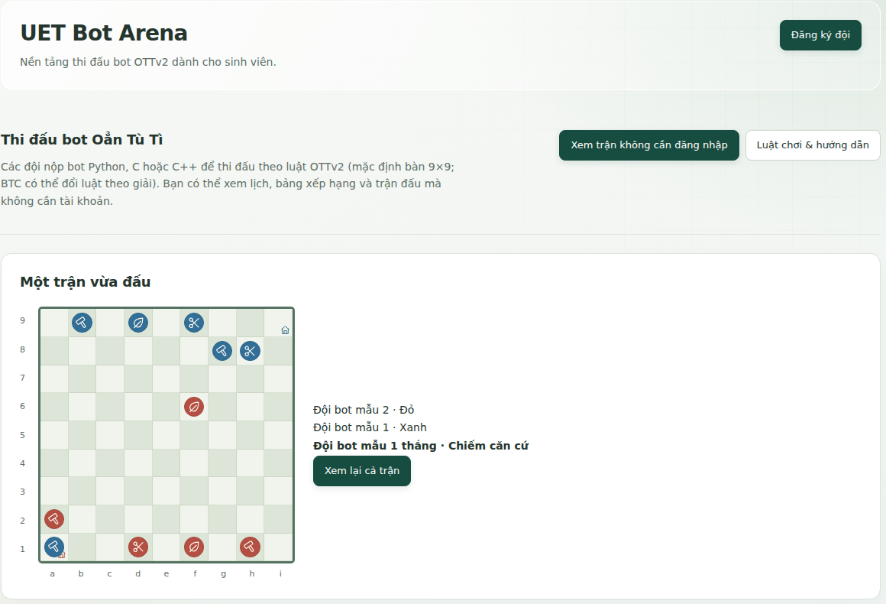
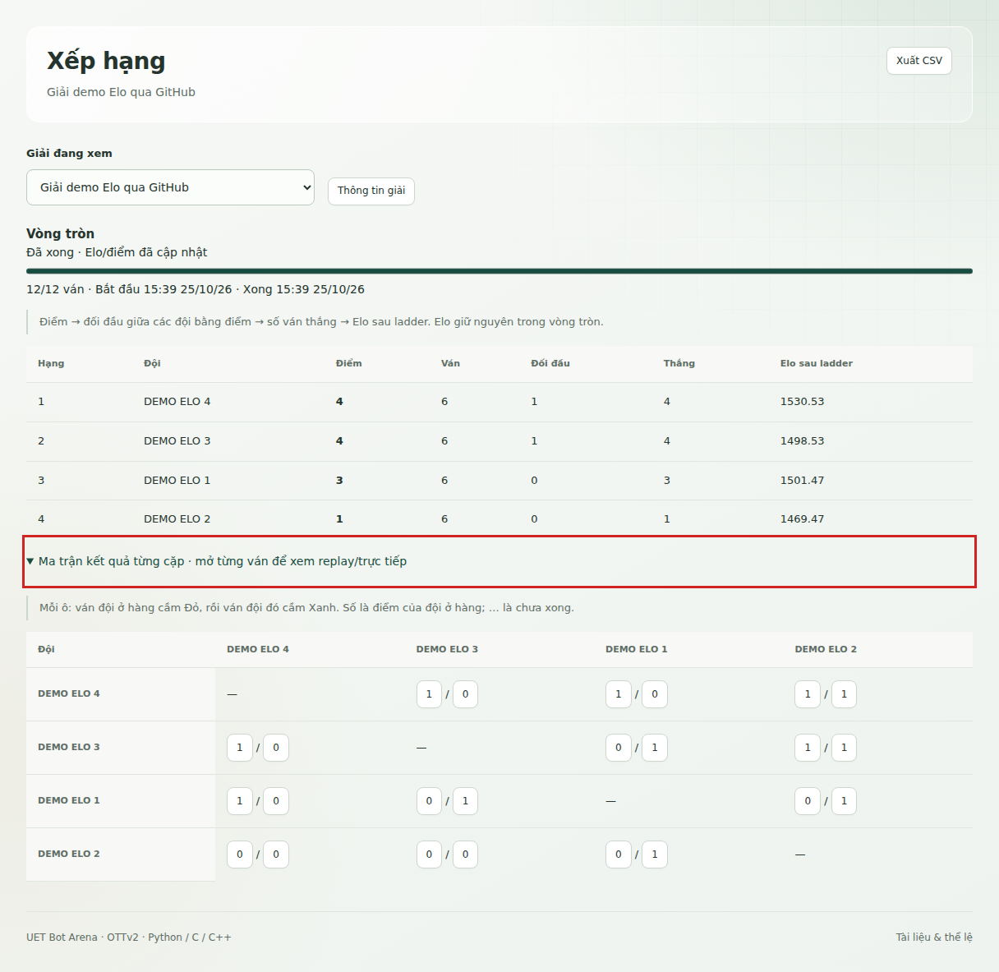
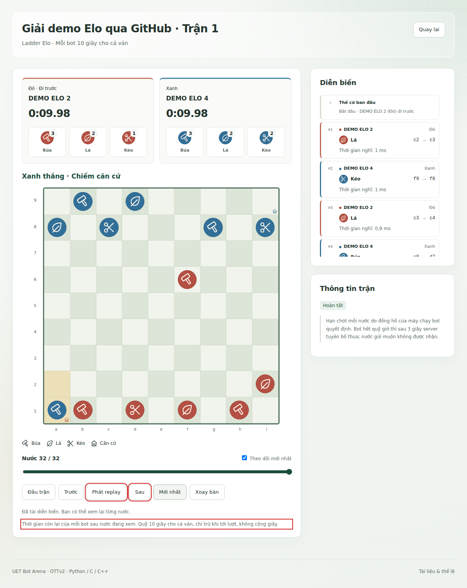
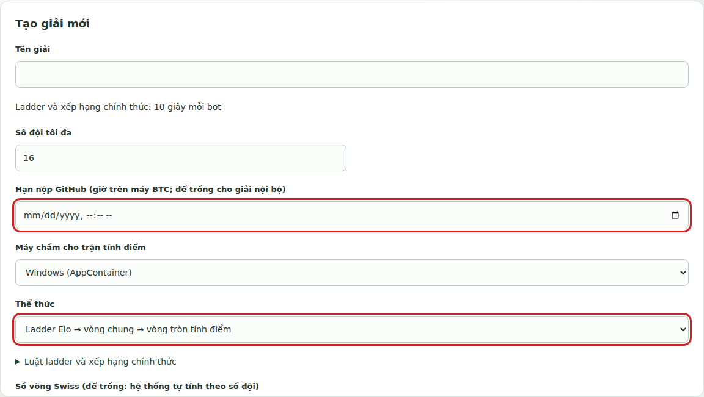

# Mở đầu

UET Bot Arena là hệ thống để sinh viên viết chương trình chơi cờ Oẳn Tù Tì và cho các chương trình thi đấu với nhau. Bài toán đặt ra hướng tới khoảng 4.000 sinh viên năm nhất, nhiều máy chấm cùng tham gia và một website công khai để theo dõi kết quả. Nhóm chọn mô hình tách máy chủ điều hành khỏi nơi chạy bot để máy chủ không phải biên dịch hoặc thực thi mã do thí sinh nộp.

Hệ thống đang chạy tại **https://uetbotarena.id.vn**. Máy chủ điều hành chạy trên VPS Ubuntu, còn các máy Windows của nhóm nhận việc qua Internet và chấm trong môi trường cô lập. Máy chấm Linux cũng đã được cài thử bằng tin nhắn cài do website cấp. Mã nguồn của dự án ở **https://github.com/uet-bot-arena/platform**; ban tổ chức cấp quyền truy cập khi kho còn riêng tư.

Hai giải demo đã hoàn tất cho phép kiểm tra sản phẩm ngay trên web. Giải vòng tròn có tám đội và 56 ván; giải qua GitHub có bốn đội, một đợt ladder và 12 ván vòng tròn chính thức, chọn hai đội. Giải thứ hai đã kiểm cả trường hợp đẩy mã sau hạn: hệ thống vẫn dùng đúng bản đã chốt trước hạn. Web còn có chung kết thử 16 đội bot mẫu chạy trên hub LAN rồi nạp lên, với nhánh đấu, 64 ván và replay.

[Phần A](giai-dau.md) dành cho người chơi và ban tổ chức: chơi thế nào, lập đội, nộp bot, hiểu lịch đấu và xem kết quả. [Phần B](thiet-ke.md) giải thích các thành phần kỹ thuật, lý do lựa chọn và những giới hạn đã biết. Muốn xem nhanh cách sử dụng, đọc [Phần C](huong-dan-demo.md) với hướng dẫn từng bước có ảnh. Mức tải đã đạt đầy đủ các tiêu chí tự đặt trên VPS là 2.000 người dùng bình thường; lượt 4.000 người chạy hết và không mất dữ liệu kiểm tra, nhưng còn chậm hơn ba tiêu chí tốc độ.

*Hình 1. Trang khách với bàn cờ một ván thật đã hoàn tất*

**Mở giải demo:** [Vòng tròn tám đội](https://uetbotarena.id.vn/#/competitions/37622233fec44da79f33cc1495117e61) và [Elo qua GitHub](https://uetbotarena.id.vn/#/competitions/99afeb9bc57049ff86510db6aaa50995). Khách xem bảng điểm và replay không cần tài khoản.

# A. GIẢI ĐẤU

## 1. Trò chơi OTTv2

OTTv2 đưa quan hệ khắc chế Đấm (trên web hiển thị là Búa), Lá, Kéo lên bàn cờ đối kháng. Bàn tiêu chuẩn có chín hàng và chín cột; cột ký hiệu từ a đến i, hàng từ 1 đến 9. Căn cứ Đỏ ở a1 và căn cứ Xanh ở i9; hai ô căn cứ để trống khi bắt đầu. Mỗi bên có chín quân, gồm ba quân cho mỗi loại, và bên Đỏ đi trước.

Mỗi lượt, một bên chọn một quân và đi đúng một ô theo một trong tám hướng. Quân được đi vào ô trống hoặc ô có quân địch mà nó ăn được. Quân không đi vào ô có đồng đội, quân địch cùng loại hoặc quân địch đang khắc chế nó. Vì vậy hai quân cùng loại chặn đường nhau, không tự tiêu diệt nhau.

| **Quan hệ**        | **Kết quả khi đi vào ô đích** |
|--------------------|-------------------------------|
| Đấm gặp Kéo        | Đấm ăn Kéo và chiếm ô         |
| Kéo gặp Lá         | Kéo ăn Lá và chiếm ô          |
| Lá gặp Đấm         | Lá ăn Đấm và chiếm ô          |
| Hai quân cùng loại | Không được đi vào ô đó        |

Một bên thắng ngay khi đưa bất kỳ quân nào vào căn cứ đối phương, hoặc ăn hết toàn bộ quân thuộc **một loại** của đối phương. Không cần ăn hết cả đội quân. Chẳng hạn, đối thủ vẫn còn sáu quân nhưng đã mất cả ba quân Kéo thì ván đã kết thúc. Người xem nên theo dõi số quân theo từng loại thay vì chỉ nhìn tổng số.

Hệ thống bổ sung quy tắc để ván bot luôn kết thúc: hết quỹ giờ, bot lỗi hoặc không còn nước hợp lệ có thể dẫn tới thua; thế cờ lặp và giới hạn số nước được xử lý theo cấu hình đã ghim của giải. Đầu hàng là một hành động hợp lệ. Lỗi máy chấm hoặc kết nối không được tự biến thành lỗi của bot; việc chấm được giao lại theo cơ chế chịu lỗi ở [phần B](thiet-ke.md#7-chịu-lỗi-và-sao-lưu).

Luật đầy đủ nằm ở trang **Tài liệu và thể lệ** trên website, có tiếng Việt và tiếng Anh. Đường dẫn văn bản chính thức là [luật tiếng Việt](https://uetbotarena.id.vn/api/v1/rules?lang=vi) và [luật tiếng Anh](https://uetbotarena.id.vn/api/v1/rules?lang=en). Các luật bàn tùy chỉnh và add-on là lựa chọn riêng của ban tổ chức; thí sinh phải đọc đúng bộ luật của giải, không suy từ bàn tiêu chuẩn.

## 2. Tài khoản và đội

Mỗi sinh viên đăng ký tài khoản cá nhân bằng email trường dạng **@vnu.edu.vn**. Website gửi mã xác minh, sau đó người dùng đặt mật khẩu. Mã có sáu chữ số và chỉ dùng cho đúng mục đích đã yêu cầu. Khi chưa thấy thư, người dùng kiểm tra cả thư mục Spam; việc máy chủ thư nhận thông điệp chưa bảo đảm thư đã vào hộp thư đến.

Mã có hạn mười phút tính từ lúc gửi thành công. Hai yêu cầu liên tiếp cho cùng địa chỉ và mục đích cách nhau ít nhất 60 giây; tổng số mã đăng ký và khôi phục mật khẩu của một địa chỉ không quá năm mã mỗi giờ và mười mã trong 24 giờ. Một mã chỉ cho thử sai tối đa năm lần. Các giới hạn này giảm khả năng một người dùng website để làm phiền hộp thư của người khác.

Sau khi đăng nhập, người dùng vào **Cá nhân và đội** để tạo đội hoặc nhập mã mời. Người tạo là đội trưởng và chia sẻ mã tám ký tự cho ba thành viên còn lại qua kênh riêng. Mỗi người chỉ thuộc một đội trong mùa hiện tại. Đội dự giải chính thức có đủ bốn sinh viên và được chốt theo hạn lập đội do ban tổ chức công bố.

| **Vai trò** | **Việc có thể làm** |
|----|----|
| Thành viên | Xem đội, nộp mã, theo dõi kiểm tra, luyện tập và rời đội trước khi chốt |
| Đội trưởng | Mời người, chỉnh đội, chuyển quyền và gắn repo GitHub; chịu trách nhiệm thông tin đội |
| Giám khảo | Có quyền theo vai trò do ban tổ chức cấp; có thể thử bằng đội khách |
| Đội khách | Luyện tập và dùng các chức năng được cho phép, không có hạng chính thức hoặc suất chung kết |
| Ban tổ chức | Quản lý người dùng, đội, giải, máy chấm và công bố kết quả |

Khi người thứ tư vào, mã mời ngừng nhận thêm người. Trước hạn, nếu có thành viên rời đội thì đội thiếu người có thể nhận lại thành viên. Đội trưởng phải chuyển quyền trước khi rời một đội còn người. Các thao tác tranh suất cuối được kiểm trong giao dịch cơ sở dữ liệu, không dựa riêng vào số người đang hiện trên màn hình.

Trang **Ghép đội** giúp người chưa đủ nhóm tìm nhau. Người dùng tự bật trạng thái tìm đội; đội trưởng tự bật trạng thái tuyển thêm người. Hồ sơ ghép đội không công khai email, mật khẩu hay mã mời. Ban tổ chức có thể xem đề xuất ghép người lẻ sau hạn, nhưng phải xác nhận trước khi thay đổi thành viên.

Quên mật khẩu dùng một luồng mã email riêng. Đặt lại thành công sẽ hủy mọi phiên đăng nhập cũ. Khách và giám khảo được cấp tài khoản qua quy trình của ban tổ chức, không tự chọn quyền quản trị khi đăng ký. Khi gặp vấn đề về email hoặc thông tin thành viên sau khi đội đã khóa, người dùng liên hệ ban tổ chức thay vì tạo tài khoản mới để lách quy trình.

## 3. Nộp bot qua GitHub

Mỗi đội dùng một repo GitHub riêng tư do đội trưởng sở hữu. Tên repo phải đúng tên hiện tại ở trang đội; mã đội là cố định dù đội đổi tên. Đội tạo repo từ [mẫu của ban tổ chức](https://github.com/uet-bot-arena/ott-bot-starter), mời ba thành viên làm cộng tác viên, rồi cài GitHub App UET Bot Arena cho đúng repo đó. Không chọn quyền truy cập tất cả repo nếu chỉ cần nộp một repo thi đấu.

Đội trưởng dán link repo tại trang đội hoặc trang **Nộp bot**. Việc gắn link chỉ làm một lần và được kiểm tên repo, trạng thái riêng tư cùng quyền của App. Một repo không đồng thời thuộc hai đội. Nếu gắn nhầm, đội liên hệ ban tổ chức để xử lý có nhật ký; tự lập đội khác để đổi mã không phải cách sửa hợp lệ.

Hub lấy source trong thư mục **bot/** của nhánh **main**. Hệ thống nhận C++17, C11 và Python; mỗi bài chỉ có một file chính tương ứng là bot.cpp, bot.c hoặc bot.py. Các file phụ cùng ngôn ngữ phải nằm phẳng trong thư mục bot. Repo không được dùng binary, liên kết tượng trưng, submodule, con trỏ Git LFS hoặc thư mục con làm bài nộp.

Đội nên thử local trước khi đẩy mã. Lệnh sau kiểm hợp đồng mẫu trong repo thí sinh, tùy môi trường cần gọi trình thông dịch Python đúng tên hoặc đúng đường dẫn:

    python run_local.py --check

Lệnh tiếp theo chạy thử để quan sát bot trong môi trường phát triển; tùy môi trường, bộ biên dịch C hoặc C++ cần nằm trong PATH:

    python run_local.py

Kết quả local giúp tìm lỗi, không thay kết quả chấm trong sandbox. Sau khi commit và push lên main, hub nhận thông báo hoặc đọc lại GitHub rồi tự kiểm **72 mẫu**. Trang Nộp bot cho biết mã bản nộp, giờ push, hàng chờ, giai đoạn biên dịch và số mẫu đã kiểm. Commit trên GitHub cũng có trạng thái Đạt hoặc Lỗi do App ghi lại.

| **Tình huống** | **Cách xử lý** |
|----|----|
| Tên repo không đúng | Sao chép nguyên tên được trang đội cung cấp |
| App chưa thấy repo | Mở phần cài App và chọn lại đúng repo riêng tư |
| Thiếu hoặc thừa file chính | Chỉ giữ một bot.cpp, bot.c hoặc bot.py trong bot/ |
| Biên dịch, giao thức hoặc nước đi lỗi | Đọc log của đúng bản, sửa source rồi push bản mới |
| Đang chờ kiểm | Giữ nguyên bản nộp; hệ thống tự giao việc khi có máy nhận |
| Hết hạn mức nhận nguồn mới | Hub giữ thông tin bản cần đọc và thử lại theo hạn mức |

Mặc định mỗi đội được nhận tối đa 30 bài nguồn mới mỗi giờ. Nhiều commit chỉ thay README nhưng không thay bot không tạo thêm một bài nguồn mới. Bài mới có thể thay lượt kiểm cùng mục đích đang chờ; nó không tùy ý hủy ván chính thức đã chốt. Giới hạn hàng đợi của một đội cũng không được làm các đội khác mất quyền được chấm.

Giải chính thức chỉ nhận commit GitHub. Để thử nhanh, sinh viên dán mã nguồn hoặc chọn một file C++17, C11 hay Python 3 trên web; bản này chỉ dùng để kiểm 72 mẫu và luyện tập, tối đa 10 bản mỗi giờ. Đội một người đã thử được; đủ bốn người mới dự giải. GitHub đồng thời giúp sinh viên tập chia sẻ mã và xem lại quá trình phát triển của nhóm.

## 4. Thể lệ và lịch đấu

### 4.1. Ladder trước hạn

Ladder là giai đoạn thi đấu trước hạn nộp để đội quan sát sức mạnh của bot. Ladder kéo dài từ lúc ban tổ chức bấm Mở giải tới hạn nộp. Ban tổ chức đặt hạn khi tạo giải và sửa được tới trước khi qua hạn. Sau hạn, hệ thống tự chạy xếp hạng chính thức như [mục 9 phần B](thiet-ke.md#9-sức-tải-và-thời-gian-đã-đo).

Ban tổ chức chọn khoảng giờ khi tạo giải, từ 1 đến 24 giờ, mặc định hai giờ và cố định suốt giải. Mốc tính từ 0:00 giờ Việt Nam mỗi ngày. Với khoảng hai giờ, các đợt mở lúc 00:00, 02:00, …, 22:00: 12 đợt/ngày, mỗi đội 24 ván ladder/ngày; ladder 14 ngày có 168 đợt. Với khoảng ba giờ, các mốc là 00:00, 03:00, …, 21:00: tám đợt và 16 ván/ngày.

Số giờ không chia hết 24 vẫn dùng được. Ví dụ năm giờ cho các mốc 00:00, 05:00, 10:00, 15:00, 20:00; đợt cuối ngày chỉ cách mốc kế tiếp bốn giờ vì lịch tính lại từ 0:00. Nếu đợt trước chưa xong, hệ thống bỏ mốc kế tiếp và chờ mốc cố định sau đó.

Đúng lúc một đợt bắt đầu, hub lấy bản **Đạt mới nhất** của từng đội tính tới mốc đó. Bản đang kiểm hoặc bản Lỗi không thay bản Đạt trước; chưa có bản Đạt thì đội chưa vào đợt. Nếu push trong lúc đợt đang chạy, đội vẫn được kiểm và luyện tập ngay, nhưng bản mới chỉ tham gia ladder từ đợt sau. Mỗi ván ghi lại mã nguồn đã dùng để có thể đối chiếu.

Mỗi cặp đá hai ván đổi màu. Hệ thống ghép các đội trong khoảng mười hạng, tránh ba đối thủ gần nhất; đội lẻ nghỉ luân phiên. Elo bắt đầu từ 1.500 và chỉ cập nhật khi cả đợt hoàn tất, theo thứ tự cặp và ván cố định. Thứ tự máy chấm trả kết quả không được quyết định Elo cuối đợt.

K của ladder là 32 trong 20 ván đầu và mười ván sau khi đổi bot, còn lại là 16. Đổi bot không xóa Elo. Chẳng hạn hai đội cùng 1.500 Elo, cùng K bằng 32, sau một ván có thắng thua sẽ thành 1.516 và 1.484. Ván luyện tập không ảnh hưởng bảng này.

### 4.2. Chốt bài tại hạn

Hub chọn lần push cuối lên main có giờ máy chủ GitHub không muộn hơn hạn. Thời gian author hoặc committer tự ghi trong Git không được dùng để chốt. Nếu bài tại hạn Lỗi, hub lùi theo lịch sử để tìm bản Đạt, kiểm bổ sung tối đa năm lần push lùi. Đội không có bản hợp lệ thì không có bài chính thức.

Push sau hạn, kể cả force-push, không thay bài đã chốt. Đội phải giữ repo riêng tư và quyền App tới khi hub đọc và khóa xong. Nếu GitHub không cung cấp được lịch sử push, nguồn dự phòng chỉ là gợi ý và cần ban tổ chức phê duyệt. Khi đã giải quyết các bản tại hạn và có đủ đội, hub tự chuyển sang xếp hạng chính thức.

### 4.3. Xếp hạng chính thức

| **Giai đoạn** | **Luật mặc định** |
|----|----|
| Vòng chung khi có hơn 64 đội | Mọi đội đấu 20 đợt nối nhau, bắt đầu từ Elo ladder; không gặp lại đối thủ trong vòng này |
| Ghép vòng chung | Ưu tiên đội gần hạng trong khoảng mười hạng; nếu không thể ghép đủ, nới phạm vi ít nhất cần thiết nhưng vẫn không gặp lại |
| Cắt nhóm đầu | Lấy 64 đội Elo cao nhất sau vòng chung |
| Vòng tròn nhóm đầu | Mỗi cặp đúng hai ván đổi màu; 64 đội thì mỗi đội có 126 ván; thắng một điểm, hòa nửa điểm, thua không điểm |
| Giải không quá 64 đội | Bỏ vòng chung, chạy vòng tròn ngay |
| Chọn chung kết | Lấy 16 đội nhiều điểm nhất và xếp hạt giống theo thứ hạng vòng tròn |

Trong vòng chung, K bằng 32 cho 20 ván chính thức đầu của đội, sau đó là 16. Vòng tròn không cập nhật Elo. Các trận vòng tròn đã có lịch sẵn và chạy song song, không phải đợi một đợt hoàn tất rồi mới mở đợt khác. Ban tổ chức công bố các số cấu hình trước giải; giải demo nhỏ có số đội và số suất khác mùa chính thức.

Bằng điểm vòng tròn thì xét lần lượt **điểm đối đầu trong nhóm bằng điểm**, **số ván thắng**, rồi **Elo sau vòng chung**; với giải không qua vòng chung thì dùng **Elo sau ladder**. Nếu vẫn hòa tại ranh giới chọn đội, ban tổ chức phải xử lý trước công bố, không tự cấp suất theo mã đội. Giải dành cho toàn bộ năm nhất, không có vòng tranh vé hoặc suất riêng theo khóa.

Mỗi bot có quỹ **10 giây cho cả ván** ở ladder và xếp hạng chính thức mặc định. Đồng hồ chỉ trừ khi bot tới lượt và không cộng giây. Ván nội bộ hoặc luyện tập có thể dùng quỹ khác. Việc đo giờ chi tiết được trình bày ở [phần B](thiet-ke.md#7-chịu-lỗi-và-sao-lưu).

## 5. Xem kết quả

Khách không cần đăng nhập để xem giải công khai, lịch, bảng xếp hạng và replay. Người chơi đăng nhập để xem bản nguồn, lượt kiểm và thông tin riêng của đội mình. Trang ladder cho biết số đợt, giờ bắt đầu, tiến độ và đợt kế tiếp. Trang đội cho biết bản dùng trong đợt hiện tại, bản dự kiến đợt sau và các đối thủ đã gặp.

*Hình 2. Bảng điểm vòng tròn của giải qua GitHub sau khi hoàn tất 12 ván*

Bảng chính thức có điểm và ma trận từng cặp, kèm đường mở replay. Elo trong giai đoạn này giữ nguyên; không nên nhầm cột Elo với tiêu chí xếp đầu tiên là điểm vòng tròn. Kết quả có thể xuất CSV để đưa vào Google Sheet bằng chức năng nhập dữ liệu. Sheet chỉ là nơi đọc kết quả, không nhận bài hoặc quyết định thứ hạng.

Replay hiển thị bàn cờ, hai bên, số quân từng loại và danh sách nước. Người xem có thể đi từng nước, phát lại hoặc tới trạng thái cuối. Khi xem trực tiếp, giao diện nhận tiến độ và giữ lại lịch sử cần thiết để nối tiếp khi mất kết nối. Dữ liệu công khai không gồm source, mật khẩu, mã máy chấm hoặc log riêng của bot.

*Hình 3. Replay một ván đã kết thúc bằng chiếm căn cứ*

ETA là khoảng ước tính dựa trên thời gian ván đã quan sát, không phải cam kết hoàn tất. Khi chưa có máy nhận việc, trang hiển thị đang xếp hàng thay vì suy đoán máy chấm đã tắt. Tab trình duyệt bị ẩn sẽ dừng hỏi định kỳ và đóng luồng theo dõi riêng; khi mở lại, nó đọc lại dữ liệu và nối từ vị trí đã nhận.

## 6. Ban tổ chức và điều hành

Tài khoản ban tổ chức được cấp riêng. Người có quyền này quản lý đội, hồ sơ, giải và máy chấm; tài khoản sinh viên không tự nâng quyền bằng dữ liệu gửi từ trình duyệt. Các thao tác quan trọng của BTC, đội và hệ thống được ghi vào Nhật ký hệ thống (tài khoản, vai trò, IP, thời gian); chỉ BTC xem được, tài khoản quản lý thấy đủ IP, BTC khác thấy IP rút gọn. Khi hai tab cùng sửa một bản, revision giúp máy chủ từ chối ghi đè dữ liệu vừa thay đổi ở nơi khác.

Khi tạo giải, ban tổ chức chọn thể thức, số đội tối đa, nền tảng chấm và hạn nộp. Elo online cần hạn nộp và các tham số ladder, nhóm đầu, số suất chung kết. Vòng tròn nội bộ hỗ trợ tối đa 32 đội; Swiss và trường số đội của Elo cho phép tối đa 4.096. Các giới hạn biểu mẫu không phải lời khẳng định máy chủ đã đo được từng quy mô đó.

*Hình 4. Phần chính của biểu mẫu tạo giải với các giá trị mặc định*

Với Elo, ban tổ chức mở giải trước hạn để hub nhận bài và chạy ladder; sau hạn hệ thống tự khóa và xếp hạng theo điều kiện đã nêu. Với vòng tròn hoặc Swiss nội bộ, đội đăng ký bài đã kiểm đúng cấu hình, ban tổ chức chốt lịch rồi bấm bắt đầu. Hai thể thức dùng thang điểm khác nhau: vòng tròn chính thức của Elo dùng một, nửa, không điểm; giải nội bộ cũ dùng ba, một, không điểm. Giải vòng tròn nội bộ xếp theo điểm, điểm đối đầu chỉ tính trong nhóm bằng điểm, rồi tổng số ván thắng; vẫn bằng thì đồng hạng. Hệ số đối đầu được tính một lần trong nhóm bằng điểm ban đầu, không chia nhóm để tính lại. Swiss giữ cách xét Buchholz; vòng tròn chính thức của Elo giữ hệ số Elo cuối cùng đã nêu ở mục 4.3.

Mỗi máy chấm được cấp một mã riêng ở trang Máy chấm. Ban tổ chức gửi mã riêng cho người vận hành, kiểm nền tảng, phiên bản, số slot và trạng thái online trước khi cho nhận trận tính điểm. Thu hồi mã khi máy không dùng nữa; máy đã thu hồi có thể xóa khỏi danh sách nhưng lịch sử ván vẫn giữ tên máy. Không mở cửa sổ cấp mã khi đang quay hoặc chụp màn hình công khai. Chỉ tài khoản BTC organizer được tạo, thu hồi, xóa máy chấm và lấy gói cài; BTC khác xem đầy đủ trạng thái nhưng không điều khiển máy chấm.

Trong lúc giải chạy, ban tổ chức theo dõi hàng đợi và trạng thái cần xử lý. Lỗi hạ tầng được thử lại có giới hạn; nếu vẫn lỗi thì xem chẩn đoán trước khi chạy lại, không sửa điểm tùy ý. Có thể đăng hoặc ẩn thông báo chung, tạm dừng giải và tiếp tục khi đã xử lý sự cố. Một giải bị chủ động tạm dừng không tự chạy lại chỉ vì hub vừa khởi động.

Khi nghi chép bot, hash trùng là tín hiệu để kiểm tra, không tự động kết luận gian lận. Ban tổ chức đối chiếu nguồn đúng bản, loại phần SDK dùng chung, xem lịch sử Git và trao đổi với đội. Việc loại hoặc khôi phục đội phải có lý do và dấu vết. Trước công bố kết quả, ban tổ chức đối chiếu điểm, xử lý các hòa tại ranh giới và xác nhận danh sách được chọn.

## 7. Chung kết tại hội trường

Mười sáu đội theo thứ hạng chính thức vòng online vào chung kết. Mỗi đội dùng một máy do ban tổ chức cấp, đã chép sẵn bot cuối vòng online, SDK và luật; máy không có Internet. Thí sinh nộp điện thoại lại trước khi thi. Không bắt buộc dùng Git; đội có thể dùng Git cục bộ để giữ các lần sửa.

Buổi sáng, đội sửa bot và tự nạp ZIP lên hub trong hội trường. Ban tổ chức mở Chung kết, chọn 16 đội và nhập hạng online 1–16 không trùng, rồi chọn thời gian, bộ luật và nền tảng chấm dùng chung. Mặc định là năm phút mỗi bot. Hệ thống kiểm từng đội đã có bản Đạt hợp cấu hình trước khi nhận bản nháp. Nếu công bố biến thể, đội phải kiểm đủ 72 mẫu theo bộ luật đó.

Khi BTC bấm Bắt đầu vòng bảng, hệ thống ghim bản Đạt mới nhất của mỗi đội tại đúng lúc đó và dùng một bản bot ấy suốt ngày; bản nạp mới hơn về sau không thay bot ở các vòng loại trực tiếp. Hệ thống tự chia bảng theo con rắn: A gồm 1–8–9–16, B gồm 2–7–10–15, C gồm 3–6–11–14, D gồm 4–5–12–13. Mỗi bảng đá vòng tròn hai lượt, 12 ván; thắng một điểm, hòa nửa điểm, thua không điểm. Xếp theo điểm → điểm đối đầu trong nhóm bằng điểm → tổng số ván thắng → hạng online. Hạng online duy nhất giúp chọn rõ nhất, nhì mỗi bảng vào tứ kết.

Hệ thống tự tạo tứ kết: TK1 là 1A–2B, TK2 là 1C–2D, TK3 là 1B–2A, TK4 là 1D–2C. BK1 nhận đội thắng TK1 và TK2; BK2 nhận đội thắng TK3 và TK4. Hai đội thắng bán kết vào chung kết, hai đội thua tranh hạng ba. Mỗi cặp vẫn là một giải vòng tròn hai đội, hai ván đổi màu. Hơn điểm thì đi tiếp; hòa điểm thì nếu mỗi đội thắng đúng một ván, đội thắng bằng ít nước hơn đi tiếp; vẫn bằng hoặc hai ván hòa thì xét hiệu số quân cộng hai ván, cuối cùng bốc thăm cố định. Bot đi nước cố định nên đá thêm ván cùng thế cờ, cùng màu sẽ ra y hệt; vì vậy chỉ xét hai ván của chính cặp, không dùng vòng bảng hay hạng online. Trang nhánh ghi đội đi tiếp và lý do, có đường mở lịch và replay của từng cặp.

Mỗi bot có năm phút cho cả ván, chỉ trừ khi đến lượt và không cộng giây sau nước đi. Một ván dùng gần hết cả hai quỹ mất khoảng mười phút, cộng khởi động và ân hạn. Các mốc dưới đây là dự toán, không phải thời gian của bot mẫu.

| **Giai đoạn** | **Số ván** | **Bốn luồng chấm** | **Tám luồng chấm** |
|----|----|----|----|
| Bốn bảng vòng tròn hai lượt | 48 | Khoảng 2 giờ | Khoảng 1 giờ |
| Tứ kết, bán kết, hạng ba, chung kết | 16 | Khoảng 40 phút | Phụ thuộc thứ tự các cặp |

Lịch mẫu: 07:30 nhận máy và kiểm mạng; 08:00–11:00 sửa bot, nạp và kiểm bài; 11:00 chốt bản Đạt; 13:00 bắt đầu vòng bảng; khoảng 15:00 chuyển sang loại trực tiếp nếu dùng bốn luồng. Mặc định hệ thống mở cặp vòng sau khi đủ kết quả nguồn. Nếu bật chờ giữa vòng, các cặp được tạo và chốt nhưng chờ BTC bấm Bắt đầu vòng. Dành thêm thời gian dự phòng sự cố, nghỉ và trao giải. Khi bấm Dừng tự động, hệ thống giữ nguyên các giải con; BTC tiếp tục bằng tay, không sửa đội thắng trên nhánh.

| **Vai trò** | **Công việc** |
|----|----|
| Ban tổ chức | Phát tài khoản, công bố hạn và luật, chốt bot, duyệt kết quả và đăng thông báo |
| Kỹ thuật | Cài hub và máy chấm, kiểm nguồn điện, mạng riêng, backup và nhận việc lại khi có lỗi |
| Trọng tài | Thu điện thoại, theo dõi đội, kiểm điểm và hệ số hòa; giám sát nhánh tự động, điều hành tay khi cần |

Sau chung kết, BTC xuất gói kết quả từ hub LAN rồi nạp lên web thật bằng một thiết bị có Internet riêng. Người xem mở lại bảng điểm, từng cặp và replay trên web; mạng thi vẫn không có Internet. Việc chuyển là một chiều và cần BTC xác nhận, không đồng bộ tài khoản, mã bot hay DB.
