# C. HƯỚNG DẪN DEMO TỪNG BƯỚC

Phần này đi theo ba vai trò (khách, thí sinh, ban tổ chức) và ngày chung kết để người đọc biết bấm ở đâu và kết quả mong đợi. Viền đỏ đánh dấu chỗ cần chú ý; các ô xám che thông tin hoặc mã không cần công khai. Ảnh tạo tài khoản, đội và luyện tập lấy trên hub local cùng phiên bản, email đi qua hộp thư thử; ảnh giải, kết quả và ban tổ chức lấy trên web thật. Các biểu mẫu quản trị chỉ được điền để chụp, không gửi thay đổi vào giải demo.

## 1. Khách xem giải

### Bước 1. Mở giải công khai

Ở trang chủ, bấm **Mở giải đấu** dưới giải muốn xem. Trang chi tiết cho biết thể thức, tiến độ và đường sang bảng điểm; khách không cần đăng nhập.

*Hình 1. Mở giải công khai*

### Bước 2. Xem bảng điểm và ma trận

Mở **Xếp hạng**, chọn đúng giải rồi bấm dòng **Ma trận kết quả từng cặp**. Mỗi ô cho biết kết quả hai đội và có đường mở replay; giải nhỏ hiển thị cột **Elo sau ladder**.

*Hình 2. Xem bảng điểm và ma trận*

### Bước 3. Xem lại từng nước

Mở replay từ một kết quả, bấm Sau để đi một nước hoặc Phát replay để xem liên tục. Đầu trang ghi thể thức và quỹ thời gian của mỗi bot cho cả ván. Khi còn dưới một phút, đồng hồ hiển thị đến 0,01 giây; mỗi nước có thêm thời gian bot đã nghĩ.

*Hình 3. Xem lại từng nước*

## 2. Thí sinh đăng ký và nộp bot

### Bước 4. Đăng ký bằng email trường

Mở **Đăng ký**, nhập email trường rồi bấm **Nhận mã**. Kiểm cả Inbox và Spam; các ô email, mã và mật khẩu trong ảnh đã được che.

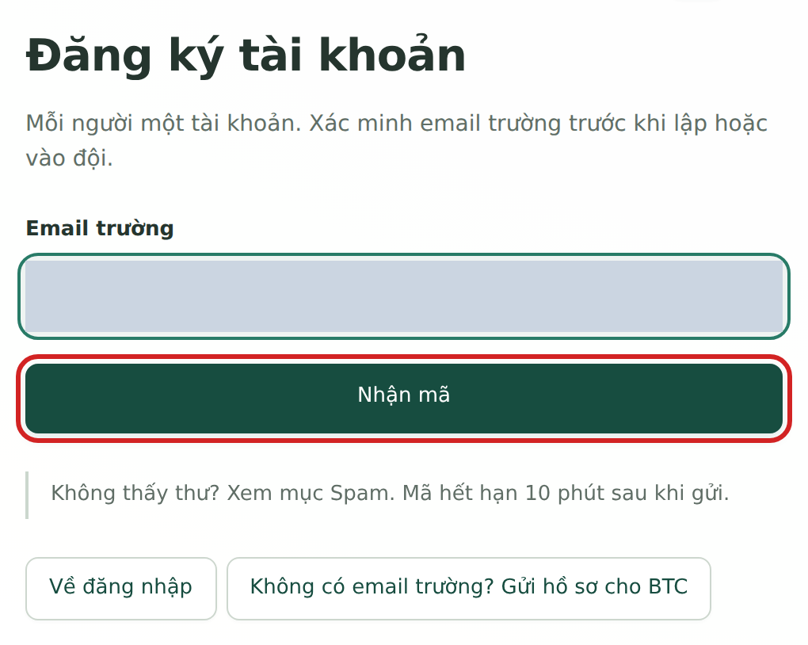

*Hình 4. Đăng ký bằng email trường*

### Bước 5. Mở email lấy mã

Mở hộp thư email trường, tìm thư từ no-reply@uetbotarena.id.vn có tiêu đề “Mã xác minh UET Bot Arena: \<mã 6 số\>”. Mã hết hạn sau 10 phút; không thấy thư thì xem Spam hoặc Junk.

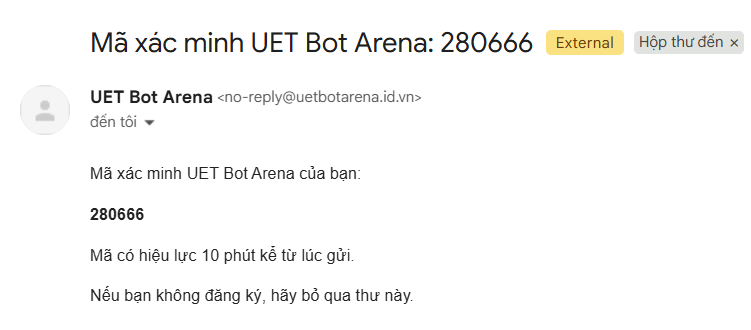

*Hình 5. Email chứa mã xác minh*

### Bước 6. Xác minh email

Nhập mã sáu số nhận qua email rồi bấm **Xác minh email**. Nếu mã hết hạn, đợi đủ khoảng cách gửi và yêu cầu mã mới, không thử đoán nhiều lần.

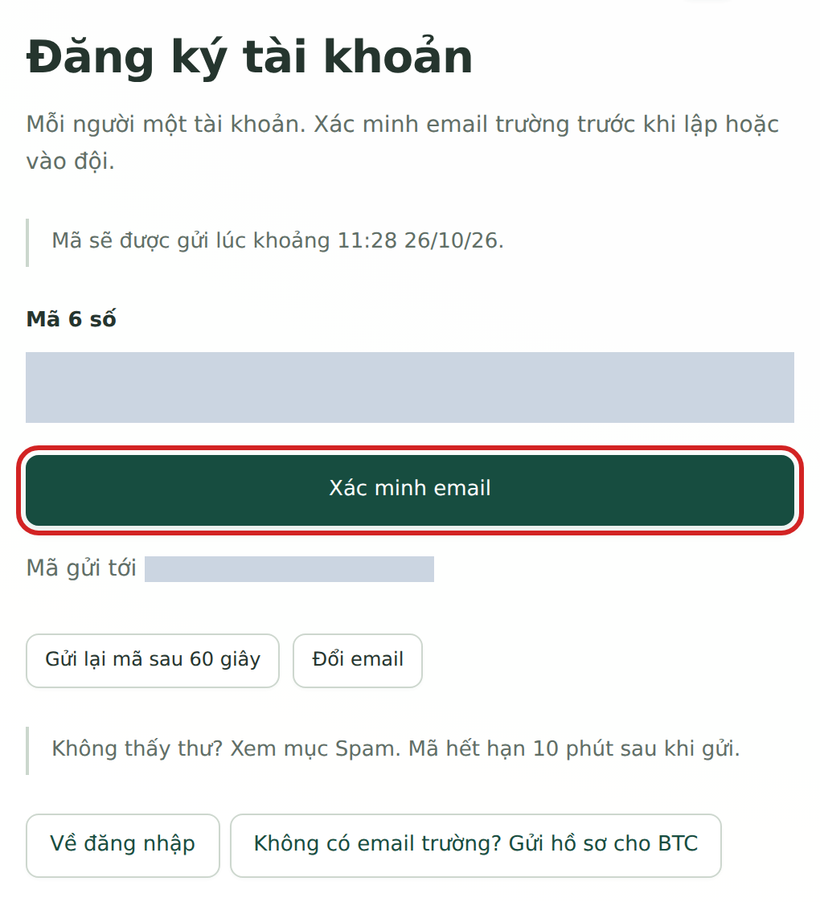

*Hình 6. Xác minh email*

### Bước 7. Đặt mật khẩu và đăng nhập

Điền họ tên, mật khẩu và phần nhập lại, sau đó bấm **Tạo tài khoản**. Khi website xác nhận thành công, chuyển sang Đăng nhập bằng email và mật khẩu vừa đặt.

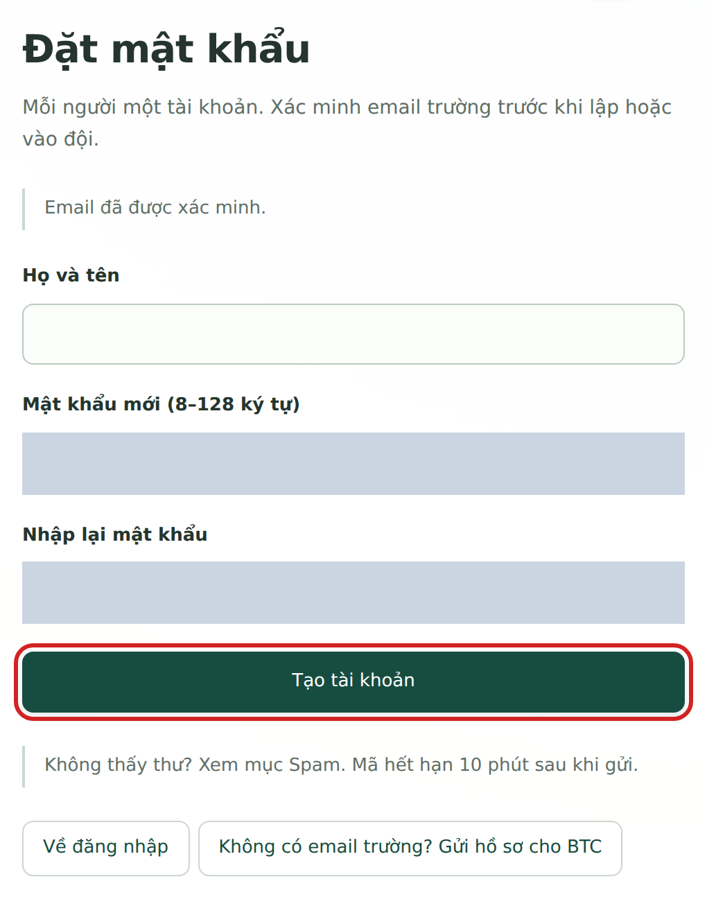

*Hình 7. Đặt mật khẩu và đăng nhập*

### Bước 8. Tạo đội

Sau khi đăng nhập, vào **Cá nhân và đội**, nhập tên rồi bấm **Tạo đội**. Người tạo trở thành đội trưởng; đội hiện số thành viên trên tổng bốn người.

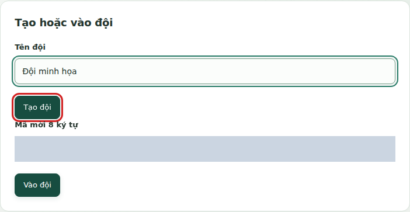

*Hình 8. Tạo đội*

### Bước 9. Mời các thành viên

Đội trưởng sao chép mã mời hoặc link mời (hai ô khoanh đỏ, đã che trong ảnh) ở trang đội rồi gửi qua kênh riêng cho ba bạn còn lại. Nút **Đổi mã mời** chỉ dùng khi cần thay mã cũ.

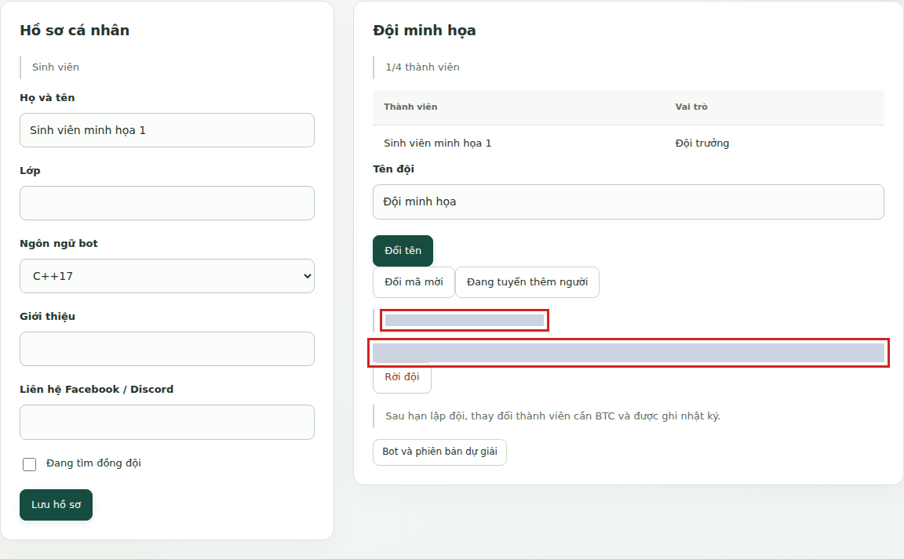

*Hình 9. Mời các thành viên*

### Bước 10. Vào đội bằng mã mời

Mỗi thành viên mở trang đội, nhập mã đội trưởng gửi rồi bấm **Vào đội**. Khi đủ bốn người, kiểm lại danh sách và vai trò trước khi nối repo.

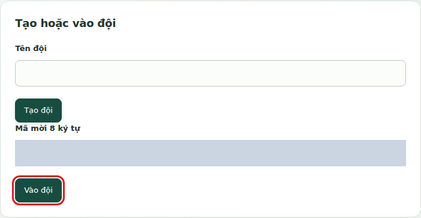

*Hình 10. Vào đội bằng mã mời*

### Bước 11. Tạo repo từ mẫu

Đăng nhập GitHub, mở repo mẫu rồi bấm **Use this template** để tạo repo riêng tư. Đặt đúng tên do trang đội cung cấp và mời ba thành viên cùng làm việc.

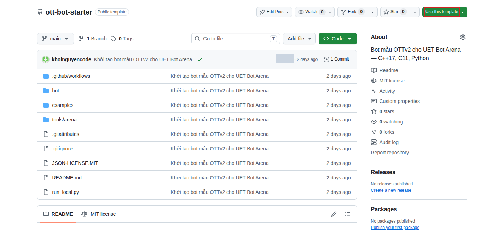

*Hình 11. Tạo repo từ mẫu*

### Bước 12. Cho App truy cập đúng repo

Mở trang GitHub App UET Bot Arena và bấm **Install** hoặc **Configure** nếu đã cài. Ở bước chọn repo tiếp theo, chỉ cấp repo nộp bot của đội; ảnh này minh họa lối vào trang cấu hình.

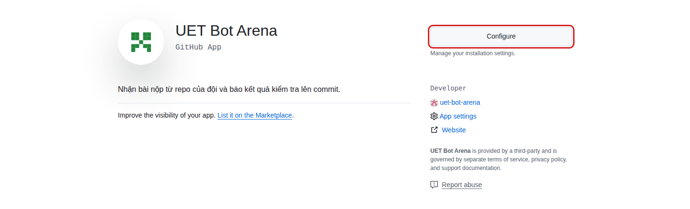

*Hình 12. Cho App truy cập đúng repo*

### Bước 13. Gắn link repo với đội

Đội trưởng trở lại trang đội hoặc **Nộp bot**, dán URL repo riêng tư rồi bấm **Gắn repo một lần**. Tên repo và quyền App phải đúng trước khi gắn; ảnh minh họa chưa gửi thao tác này lên web thật.

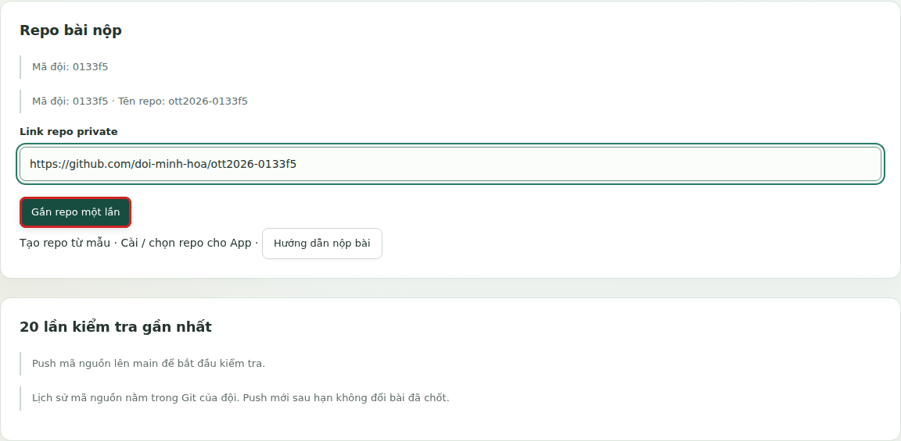

*Hình 13. Gắn link repo với đội*

### Bước 14. Theo dõi kiểm tra 72 mẫu

Push mã trong thư mục **bot/** lên nhánh **main**, sau đó mở **Nộp bot** để xem tiến độ và dấu **Đạt** hoặc **Lỗi**. Bấm **Log kiểm tra** của đúng bản để đọc chẩn đoán; ảnh dùng một đội demo đã có kết quả thật.

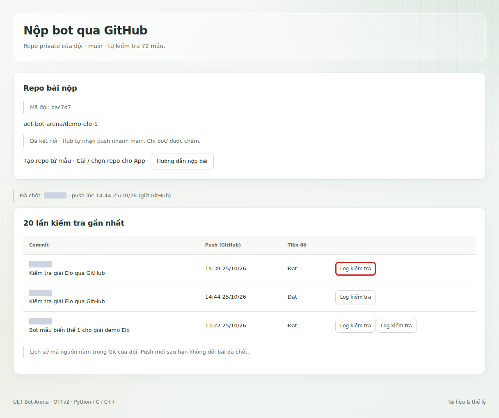

*Hình 14. Theo dõi kiểm tra 72 mẫu*

### Bước 15. Thử nhanh không cần GitHub

Mở Nộp bot, xuống khung Thử nhanh không cần GitHub. Chọn ngôn ngữ rồi dán mã hoặc chọn file; có thể bấm Điền bot mẫu C++. Bấm Nạp và kiểm tra, mở log của bản thu-xxxxxxx để xem 72 mẫu. Khi Đạt, sang Luyện tập để đấu bot mẫu hoặc phiên bản khác của đội. Bản thử nhanh không được dùng để đăng ký giải.

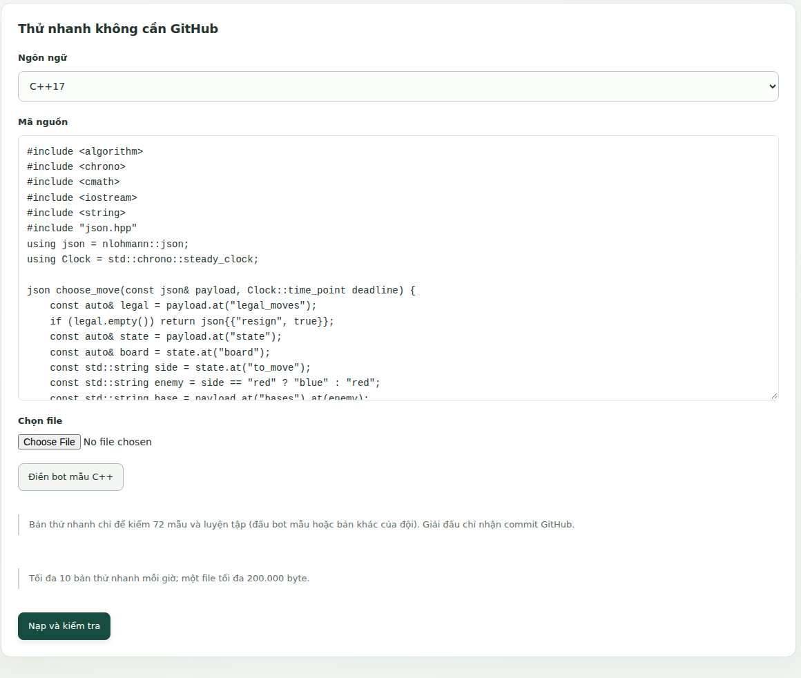

*Hình 15. Thử nhanh bằng mã nguồn hoặc một file*

### Bước 16. Xem giải của đội

Mở **Cá nhân & đội** hoặc **Tổng quan** để xem khung **Giải của đội**. Đối chiếu trạng thái tham gia, hạng, Elo hoặc điểm, số ván và đợt kế tiếp; bấm **Mở giải** để xem bảng điểm và replay.

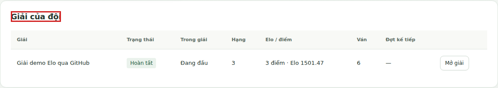

*Hình 16. Xem giải của đội*

### Bước 17. Luyện tập với bot mẫu

Khi đã có bài hợp lệ, mở **Luyện tập**, chọn bài của đội và **Bot mẫu BTC**, giữ quỹ giờ phù hợp rồi bấm **Tạo trận luyện tập**. Website mở ván để xem trực tiếp hoặc replay; ván này không đổi Elo.

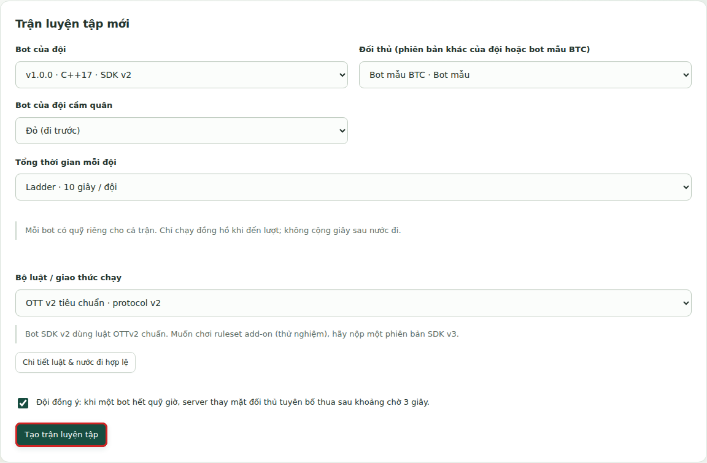

*Hình 17. Luyện tập với bot mẫu*

## 3. Ban tổ chức điều hành

### Bước 18. Xem tổng quan ban tổ chức

Với tài khoản có quyền ban tổ chức, mở trang tổng quan để xem số đội, việc chờ và tải. Đọc các chỉ số trước khi quyết định mở giải hoặc bổ sung máy chấm.

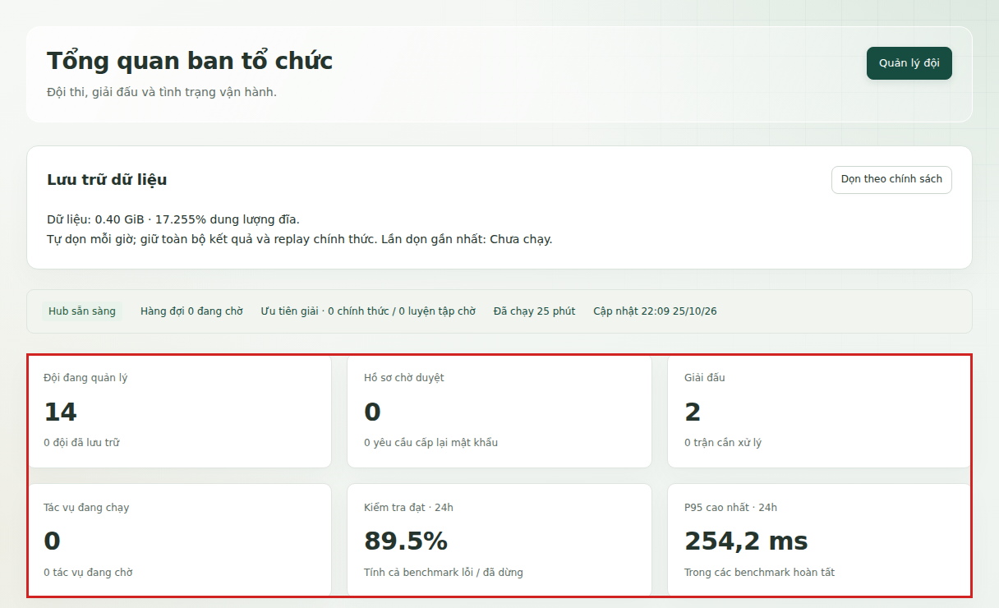

*Hình 18. Xem tổng quan ban tổ chức*

### Bước 19. Chọn giải ở Tổng quan

Tại **Tổng quan**, chọn **Giải** để xem số đội đang đấu, đội đủ hoặc chưa đủ điều kiện, tiến độ và hàng đợi của riêng giải đó. Bộ lọc cũng có ở **Đội & tài khoản** và **Người dùng & lập đội**; tải lại trang vẫn giữ lựa chọn trên đường dẫn.

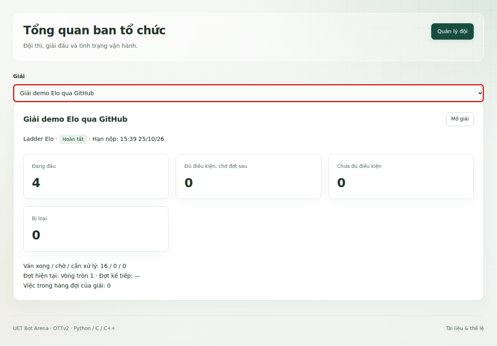

*Hình 19. Chọn giải ở Tổng quan*

### Bước 20. Chuẩn bị giải mới

Vào **Giải đấu**, chọn Elo và điền tên, số đội, hạn nộp theo giờ Việt Nam cùng nền tảng chấm. Ô thời gian chung được ẩn vì ladder và chính thức dùng 10 giây mỗi bot; kiểm toàn bộ cấu hình trước khi tạo, ảnh chưa gửi biểu mẫu. Hạn nộp quyết định ladder kéo dài bao lâu; mở mục Luật ladder và xếp hạng chính thức để đặt khoảng giờ (mặc định hai giờ), dòng bên dưới cho biết giờ mở từng đợt.

*Hình 20. Chuẩn bị giải mới*

### Bước 21. Cài máy chấm Windows hoặc Linux

Mở **Máy chấm**, bấm **Tạo mã máy chấm** rồi sao chép tin nhắn đúng hệ điều hành để gửi riêng cho người vận hành. Link trong tin nhắn hết hạn sau bảy ngày; lệnh tự kiểm file tải bằng SHA-256. Khung **Cài máy chấm** chỉ nêu yêu cầu máy và có hai nút sao chép lệnh dừng/gỡ, không hiển thị link hoặc lệnh cài; ảnh không mở cửa sổ tạo mã.

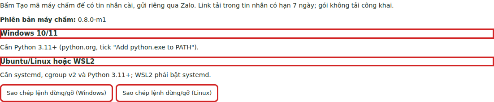

*Hình 21. Cài máy chấm Windows hoặc Linux*

### Bước 22. Kiểm tình trạng chấm và hàng đợi

Trên trang **Máy chấm**, đối chiếu số máy Online, slot và việc đang chờ với bảng từng máy. Ảnh chụp sau thử phục hồi cho thấy hai máy Windows, tổng bốn slot; tên và runtime đã che.

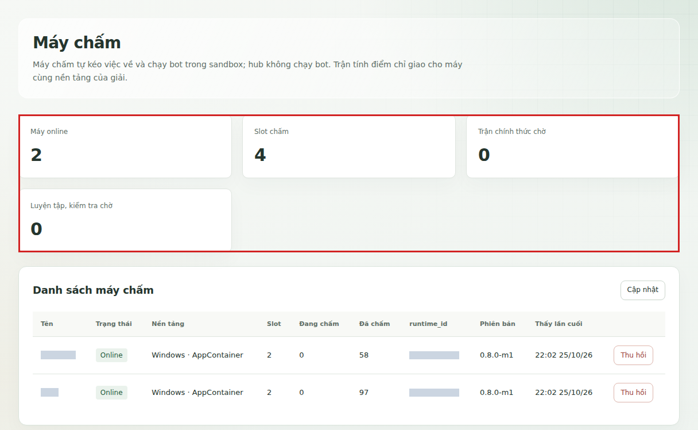

*Hình 22. Kiểm tình trạng chấm và hàng đợi*

### Bước 23. Soạn thông báo

Vào **Thông báo**, điền tiêu đề và nội dung rồi bấm **Đăng thông báo** khi đã kiểm. Ảnh chỉ điền biểu mẫu minh họa, không tạo thông báo công khai trên giải đang có.

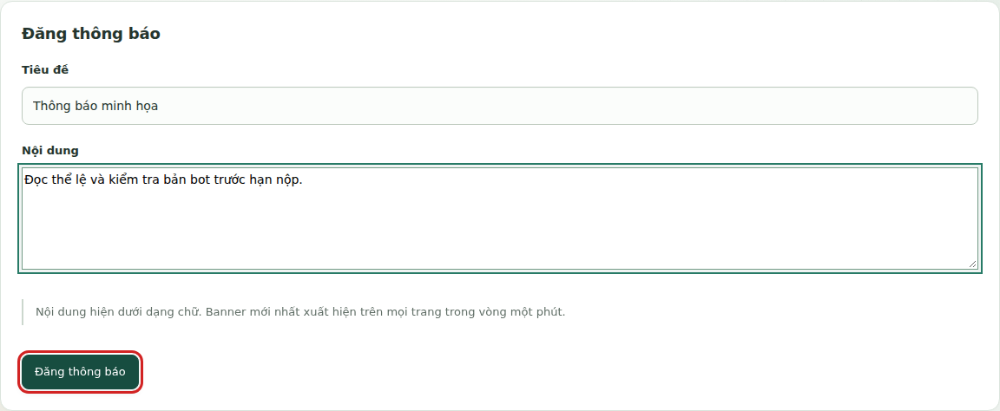

*Hình 23. Soạn thông báo*

### Bước 24. Xuất bảng điểm CSV

Mở bảng xếp hạng giải vòng tròn demo, bấm **Xuất CSV** ở góc trên. File có thể nhập vào bảng tính để trình bày kết quả; việc xuất không thay điểm hay bài đã chốt.

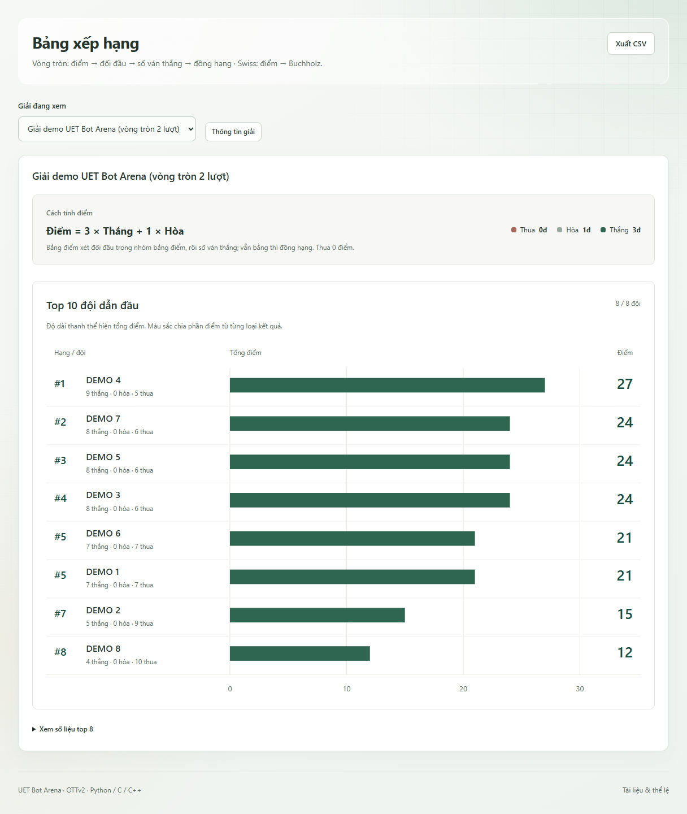

*Hình 24. Xuất bảng điểm CSV*

## 4. Ngày chung kết

Web thật có một chung kết thử 16 đội bot mẫu đã chạy trên hub LAN rồi nạp lên (thẻ chung kết trong Giải đấu) để xem nhánh đấu và replay.

### Bước 25. Tạo tài khoản và phát giấy cho đội

Trên hub LAN, ban tổ chức vào Đội & tài khoản → Thêm đội, nhập đủ bốn thành viên và cấp tài khoản. In thông tin vừa cấp để phát riêng, không chiếu mật khẩu lên màn hình chung. Đội đăng nhập và đổi mật khẩu tạm trước khi nộp bot.

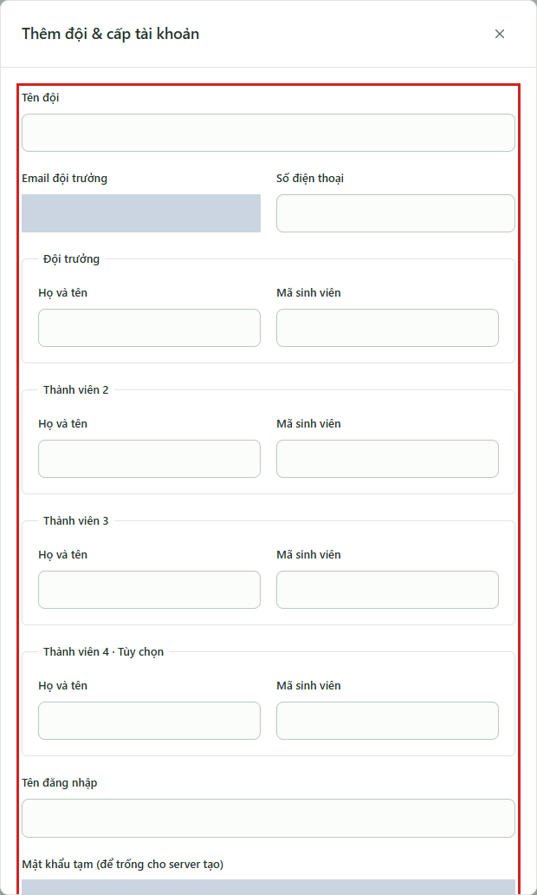

*Hình 25. Phần đầu biểu mẫu tạo đội trên hub LAN*

### Bước 26. Đội tự nạp ZIP và kiểm tra

Đội mở Nộp bot, chọn ZIP thư mục bot như repo mẫu, ngôn ngữ và phiên bản, rồi bấm Nạp và kiểm tra. Hub tự giao 72 mẫu cho máy chấm. Chờ Đạt; ZIP lỗi hoặc bản chưa kiểm xong không đủ điều kiện được chọn thi.

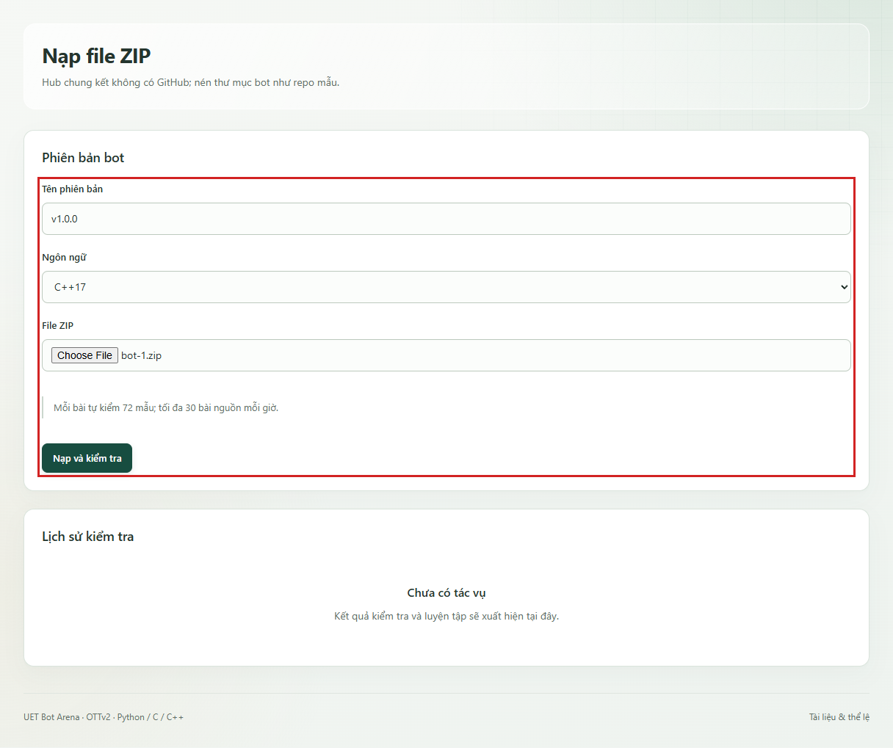

*Hình 26. Nạp ZIP trên hub LAN*

### Bước 27. BTC tạo chung kết

Mở Chung kết bằng tài khoản BTC, chọn 16 đội, nhập hạng online 1–16, chọn năm phút mỗi bot cùng bộ luật và nền tảng chấm. Bấm Tạo bản nháp, kiểm lại danh sách rồi Bắt đầu vòng bảng. Hệ thống lấy bản Đạt mới nhất lúc bắt đầu, tự chia bốn bảng, chốt và chạy 48 ván. Bật chờ giữa vòng nếu cần BTC điều khiển giờ mở vòng sau.

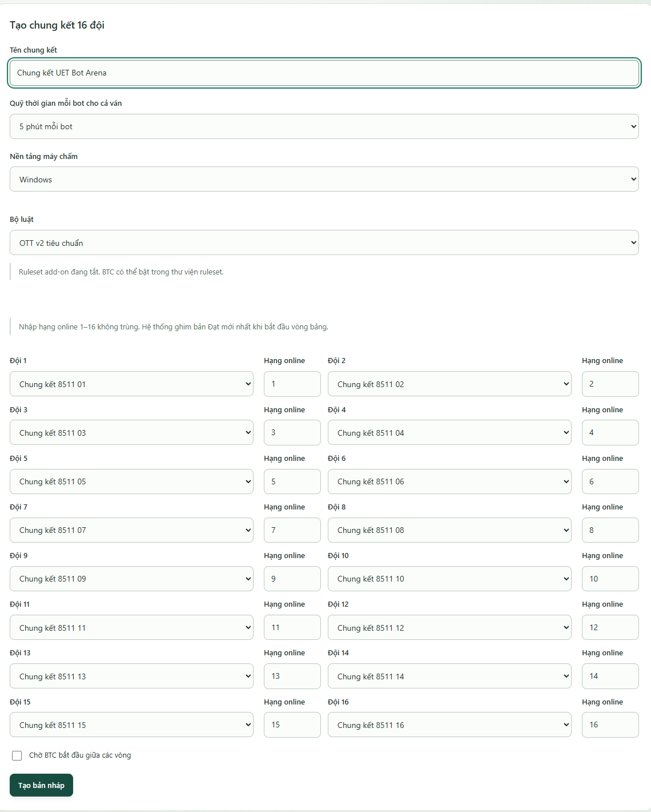

*Hình 27. Tạo chung kết với 16 đội và hạng online*

### Bước 28. Theo dõi vòng bảng và replay

Từ thẻ bảng trên trang Chung kết, mở Lịch / replay hoặc Bảng xếp hạng để xem từng ván. Điểm đối đầu, số ván thắng và hạng online quyết định thứ tự bảng khi bằng điểm; hai đội đầu được đánh dấu Vào tứ kết khi bảng hoàn tất. Ván lỗi chờ BTC xử lý và chạy lại bằng công cụ của giải con; hệ thống không tự đổi lỗi hạ tầng thành thua.

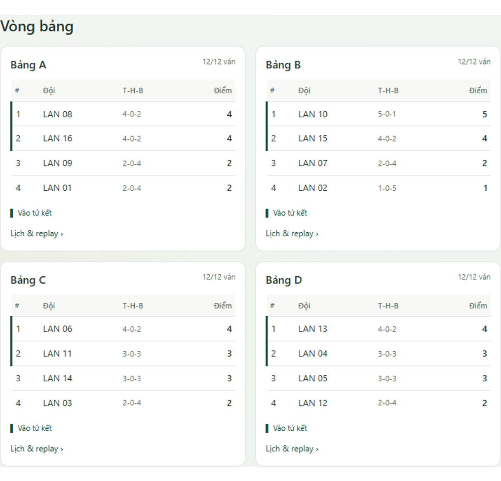

*Hình 28. Bảng hoàn tất, xếp theo các hệ số đã công bố*

### Bước 29. Trang nhánh đấu và màn hình chiếu

Trang Chung kết tự nối tứ kết, bán kết, chung kết và tranh hạng ba; cặp đang đấu được tô nổi. Bấm ô cặp để xem 2 ván, lý do đi tiếp và replay. BTC mở Màn hình chiếu trên hub LAN để có nền tối, chữ lớn, không thanh bên và tự cập nhật mỗi ba giây. BTC có thể Dừng tự động để giữ nguyên các giải con và làm tiếp bằng tay; không có nút sửa đội thắng.

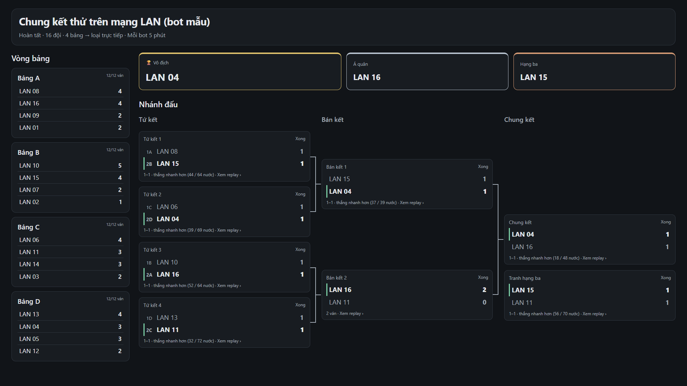

*Hình 29. Nhánh chung kết và tranh hạng ba trên màn hình chiếu*

### Bước 30. Xuất kết quả trên hub LAN

Trên hub LAN, mở Giải đấu rồi bấm Xuất kết quả lên web. Nhập tên sự kiện; chọn chung kết tự động để lấy toàn bộ bảng, cặp và nhánh, hoặc chọn từng giải đã xong theo thứ tự muốn công bố. Tải file .json.gz và giữ bản gốc để đối chiếu. Chỉ xuất giải hoặc chung kết đã hoàn tất.

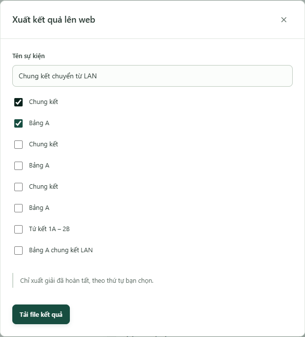

*Hình 30. Chọn các giải đã hoàn tất để xuất từ hub LAN*

### Bước 31. Nạp kết quả lên web thật

Trên web thật, BTC mở Giải đấu → Nạp kết quả từ hub LAN, chọn file rồi bấm Kiểm tra & xem trước. Đối chiếu tên, thứ tự giải, số đội, số ván, replay và SHA trước khi bấm Đăng lên web. Khách mở thẻ chung kết trong Giải đấu để xem bảng điểm và replay; giải nhập chỉ để xem, không có nút điều hành.

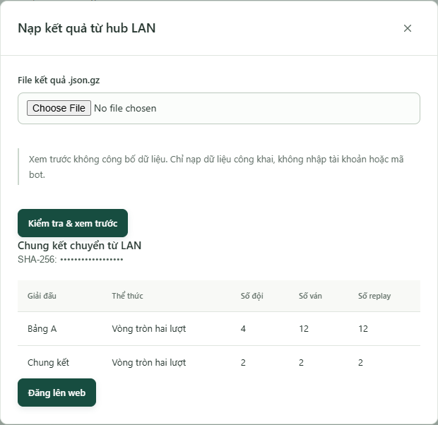

*Hình 31. Xem trước rồi xác nhận nạp kết quả lên web*

<!-- M3-11 new step -->
## 5. BTC thử tạo giải vòng tròn

### Bước 32. BTC thử tạo giải vòng tròn 4 đội

Đăng nhập bằng tài khoản BTC được nhóm cấp, vào Giải đấu → Tạo giải, chọn Vòng tròn hai lượt, tối đa 4 đội và nền tảng/quỹ giờ khớp bản Đạt của DEMO 1–4. Ở chi tiết giải, dùng Thêm đội để thêm lần lượt DEMO 1, DEMO 2, DEMO 3, DEMO 4 rồi Mở đăng ký → Chốt bot và tạo lịch → Bắt đầu giải. Mở bảng điểm và replay khi đủ 12 ván; sau khi xem xong, bấm **Xóa** và xác nhận để ẩn giải (lưu trữ mềm), giữ kết quả nhưng không để lẫn với giải đang dùng. Ảnh dưới là lượt thử local bằng BTC không có quyền quản lý máy chấm, chọn Linux và 1 phút mỗi bot theo bản Đạt đã kiểm; không sửa đội hay giải demo cũ trên web thật.

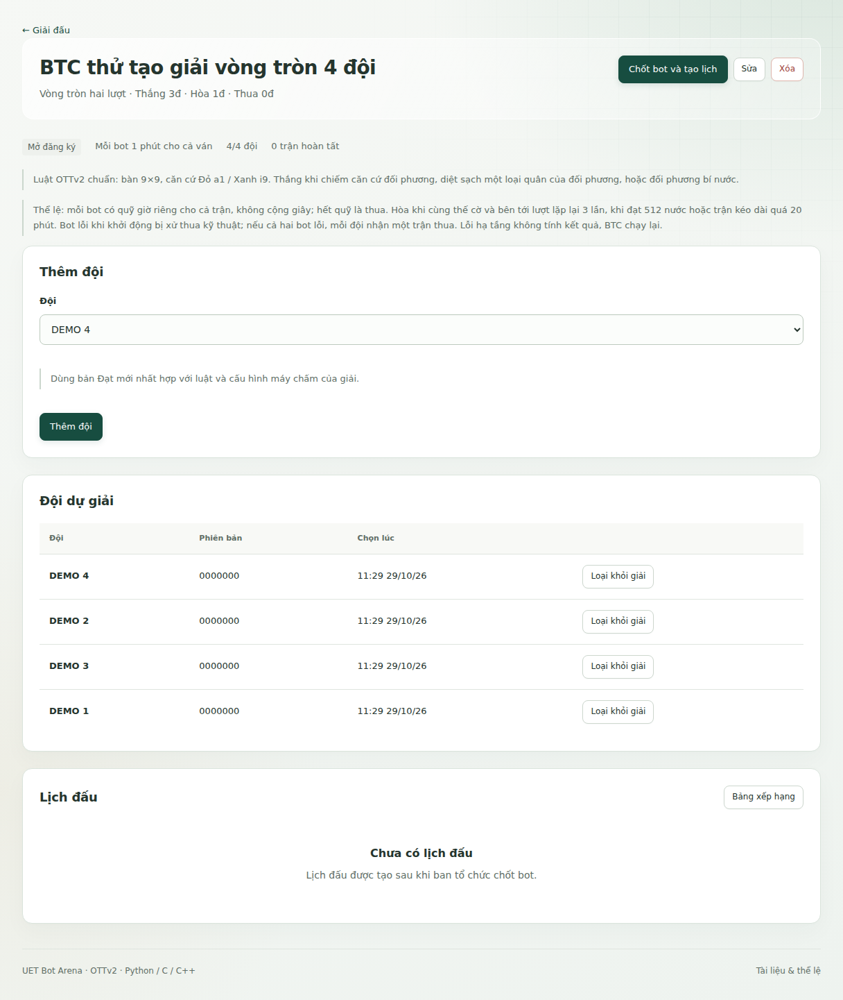

*Hình 32. BTC thử tạo giải vòng tròn bốn đội trên hub local*
<!-- /M3-11 new step -->
