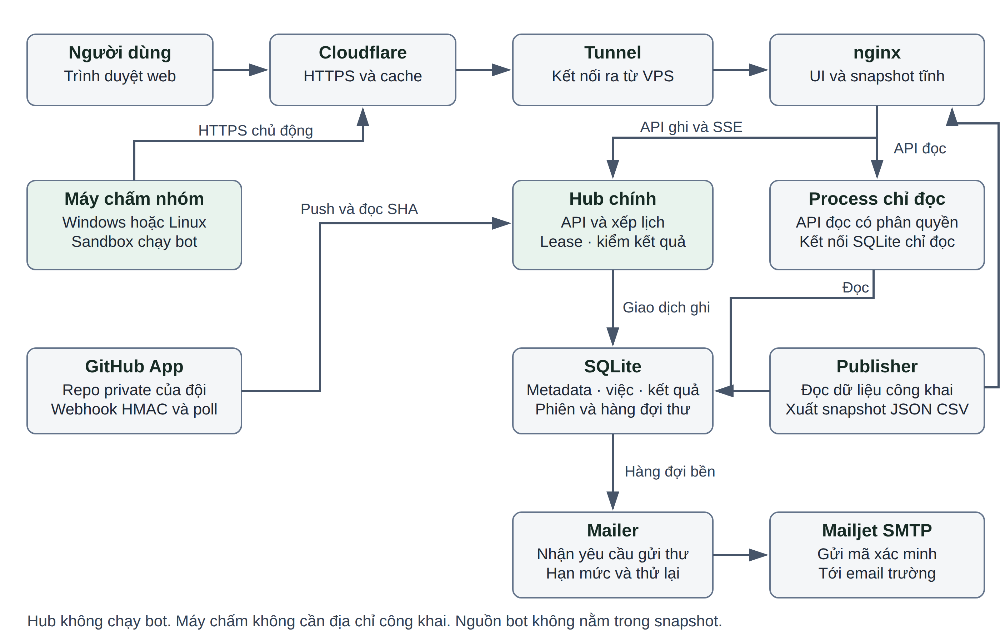
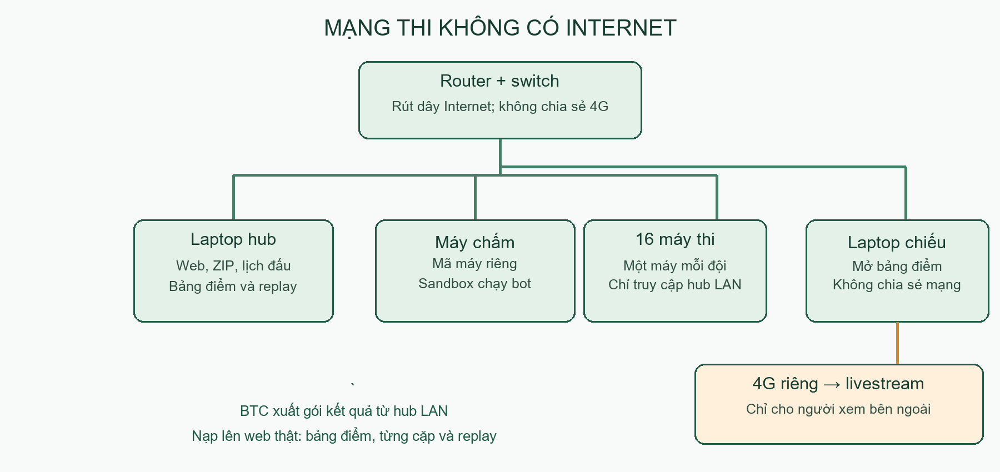

# B. THIẾT KẾ KỸ THUẬT

## 1. Kiến trúc tổng thể

Hệ thống tách nơi điều hành giải khỏi nơi chạy mã sinh viên. Hub lưu đội, phiên bản bài, lịch và kết quả; hub không chạy bot. Các máy chấm của nhóm chủ động nối ra hub qua HTTPS để lấy việc và gửi kết quả, nên không cần IP công khai hoặc mở cổng vào trên laptop. Trình duyệt cũng chỉ đi qua tên miền HTTPS.

*Hình 1. Kiến trúc triển khai; các mũi tên biểu diễn kết nối hoặc yêu cầu giữa các thành phần*

Cloudflare tiếp nhận kết nối công khai, sau đó chuyển qua tunnel tới nginx trên VPS. nginx trả thẳng giao diện và snapshot; yêu cầu nghiệp vụ đi vào hub hoặc hai process chỉ đọc. Publisher xuất bản dữ liệu công khai thành file, còn mailer xử lý hàng đợi email riêng. Cách tách này tránh việc mỗi người xem đều làm hub đọc lại toàn bộ lịch sử giải.

GitHub App báo sự kiện bằng webhook có chữ ký; hub đọc lại dữ liệu từ GitHub trước khi nhận bài. Một vòng hỏi định kỳ bù cho sự kiện bị lỡ. SQLite chứa metadata, hàng đợi và kết quả; nguồn, binary và replay nén nằm ở vùng file riêng, không phải thư mục web công khai. Mailjet nhận thư từ mailer qua SMTP.

Nhóm chọn một hub trung tâm để có một nơi quyết định lease, lịch và thứ hạng. Nhiều hub cùng ghi hoặc cơ chế ngang hàng sẽ cần thêm đồng thuận và xử lý xung đột, vượt phạm vi hiện tại. Điểm đổi lại là VPS vẫn là điểm phụ thuộc chung; thêm máy chấm chỉ tăng khả năng chạy ván, không tự tăng khả năng phục vụ web.

## 2. Dịch vụ được dùng

| **Thành phần** | **Vai trò và lý do chọn** | **Giới hạn cần tính tới** |
|----|----|----|
| VPS Ubuntu 24.04, 4 vCPU, 2 GB RAM, ổ 40 GB | Chạy hub và các dịch vụ nền liên tục; quản trị qua SSH | Hiệu năng vCPU phụ thuộc nhà cung cấp; dung lượng phải theo dõi cả backup |
| Tên miền uetbotarena.id.vn | Một địa chỉ thống nhất cho web, máy chấm và webhook | Đổi tên miền phải đổi cấu hình origin, App và máy chấm |
| Cloudflare Free và tunnel | HTTPS, cache file công khai, chuyển tiếp mà không mở cổng ứng dụng | Luật chống bot có thể chặn máy chấm hoặc webhook nếu cấu hình sai |
| GitHub App | Lấy đúng repo được cấp quyền và đúng SHA, báo trạng thái kiểm | Phụ thuộc quyền cài App, mạng và hạn mức API của GitHub |
| Mailjet | Gửi mã xác minh và khôi phục qua SMTP | Cấu hình hiện tại giới hạn 200 thư mỗi ngày; SMTP nhận không bảo đảm thư vào Inbox |

## 3. Hub và cách phục vụ dữ liệu

Hub dùng FastAPI để cung cấp API và SQLite để lưu dữ liệu. SQLite phù hợp với một máy chủ có lượng ghi vừa phải, giúp sao lưu và khôi phục đơn giản hơn việc triển khai thêm một cụm cơ sở dữ liệu. Nó không biến các thao tác ghi thành song song: giao dịch và khóa dài vẫn có thể làm mọi yêu cầu chờ nhau.

Cơ sở dữ liệu dùng WAL với chế độ synchronous=NORMAL. WAL cho phép đọc trong lúc ghi; NORMAL giảm thời gian chờ ổ đĩa so với FULL. Khi chỉ kill process, giao dịch đã hoàn tất vẫn còn; nếu cả VPS mất điện hoặc kernel sập, có thể mất khoảng 30 giây ghi cuối dù cấu trúc cơ sở dữ liệu vẫn nhất quán. Nhóm chấp nhận đánh đổi này cùng cơ chế chạy lại ván và backup, thay vì hứa không mất dữ liệu trong mọi sự cố.

API ghi nghiệp vụ đi vào process chính. Hai process chỉ đọc chỉ phục vụ danh sách route đã cho phép; chúng không xử lý các yêu cầu đổi đội, nộp bài hoặc ghi kết quả. Mailer có kết nối riêng để cập nhật hàng đợi thư. Cờ hub.read_workers đặt về 0 và cài lại cấu hình cho phép trở về cách phục vụ một process.

Publisher đọc dữ liệu và xuất snapshot công khai theo lô. Người đã đăng nhập cũng đọc bảng xếp hạng từ cùng snapshot như khách; dữ liệu riêng vẫn qua API có kiểm quyền. nginx có thể chuyển sang process đọc còn lại hoặc hub chính nếu một process đọc mất kết nối. Không cache API cá nhân tại Cloudflare.

Giao diện dừng hỏi khi tab bị ẩn. Trang đội và bài nộp hỏi mỗi 30 giây, rút xuống 3 giây khi đang có bài kiểm; mỗi lượt chỉ tải dữ liệu rồi thay phần đã đổi trên trang, không tải lại trang, giữ vị trí cuộn, ô đang gõ và mục đang mở; dữ liệu chung đọc snapshot mỗi 10 giây. SSE dùng cho theo dõi riêng và trực tiếp, có giới hạn bốn luồng mỗi người. Khi nối lại, client dùng vị trí đã nhận để tránh nhân đôi dữ liệu.

Mật khẩu dùng Argon2 từ bản thư viện chuẩn đã ghim. Số worker băm bằng một nửa số vCPU, tức hai worker trên VPS hiện tại. Sinh viên, cán bộ/giám khảo và đội khách tự đăng xuất sau một giờ bỏ không, tối đa 24 giờ từ lúc đăng nhập. Ban tổ chức tự đăng xuất sau 30 phút bỏ không, tối đa 12 giờ. Các lượt tự hỏi nền và kết nối SSE không gia hạn phiên. Nhóm chọn hai loại hạn này tham khảo hướng dẫn quản lý phiên của [NIST SP 800-63B-4](https://pages.nist.gov/800-63-4/sp800-63b/session/) và [OWASP Session Management Cheat Sheet](https://cheatsheetseries.owasp.org/cheatsheets/Session_Management_Cheat_Sheet.html).

## 4. Máy chấm và chia việc

Máy chấm lấy một lease có thời hạn, gửi heartbeat trong lúc làm và gửi kết quả gắn với lease đó. Lease mặc định 30 giây; heartbeat hợp lệ gia hạn quyền xử lý. Nếu máy mất mạng hoặc tắt, hub đợi hết hạn rồi giao lại việc. Kết quả của lease cũ bị từ chối bằng cơ chế fencing, nên một ván được tính điểm một lần.

Lỗi hạ tầng được thử lại tối đa ba lần tự động. Hết số lần này, việc cần người vận hành xem chẩn đoán; lỗi hạ tầng không tự biến thành thua của bot. Máy có thể vào hoặc rời cụm mà không đổi bản bot đã khóa. Đây là chia việc cho các máy được nhóm tin cậy, chưa phải giao thức chống máy chấm cố ý giả kết quả.

Mỗi giải ghim nền tảng và runtime. Giải chính thức Windows chỉ giao ván tính điểm cho máy Windows cùng runtime; máy Linux vẫn có thể nhận kiểm tra và luyện tập phù hợp. Không trộn kết quả hai nền tảng rồi mặc định tốc độ bot tương đương. Việc nâng runtime giữa mùa cần được kiểm và điều hành như thay đổi môi trường thi.

*Hình 2. Trang quản lý máy chấm trên web thật; tên máy được che, trạng thái phản ánh thời điểm chụp*

Ban tổ chức tạo mã máy chấm và gửi tin nhắn cài qua kênh riêng. Tin nhắn có link tải hạn bảy ngày cho Windows hoặc Linux; gói không tải công khai. Windows dùng toolchain cục bộ; Linux cần bubblewrap, cgroup v2 và cấu hình hệ thống phù hợp. Trước khi nhận trận, máy tự báo phiên bản, nền tảng, runtime và số slot để ban tổ chức kiểm. Mã máy chấm phải nằm ngoài repo và được thu hồi khi máy không còn dùng.

Mỗi ván chạy đồng thời cần dành một luồng CPU và khoảng 1 GB RAM, ngoài phần dành cho hệ điều hành. Tăng số slot trên cùng PC không tạo thêm tài nguyên vật lý. Khi bổ sung laptop cho đêm xếp hạng, nhóm cần cắm nguồn, tránh sleep, kiểm mạng và thử một ván có replay trước; chỉ cộng slot của những máy đủ điều kiện nền tảng.

Trên Windows, máy chấm tự chạy khi đăng nhập đúng tài khoản đã cài, không phải ngay khi nhấn nút nguồn. Sau khi dùng chức năng dừng, chỉ cần mở lại shortcut; máy chấm tự xóa dấu dừng cũ và tiếp tục nhận việc. Thử trên máy Windows thật cho thấy máy online lại sau 4,97 giây và nhận được lượt kiểm, không phải xóa file bằng tay. Bản hiện tại chưa có dịch vụ tự khởi động lại tiến trình Windows nếu nó thoát do lỗi; người vận hành cần xem nhật ký khi máy bật nhưng vẫn Offline.

## 5. Sandbox chạy bot

Bot là mã không tin cậy. Trước khi chạy, máy chấm kiểm cấu trúc nguồn và biên dịch trong môi trường có giới hạn; lúc thi đấu tiếp tục hạn chế tài nguyên và quyền truy cập. Việc biên dịch thành công không có nghĩa bot được quyền đọc file cá nhân hoặc mở kết nối mạng.

Trên Windows, AppContainer hạn chế quyền của tiến trình và Job Object quản lý cây tiến trình, bộ nhớ và thời gian. Máy chấm khởi tạo bot với tập file cần thiết thay vì quyền người dùng đầy đủ. Cách này chạy trực tiếp trên Windows, không yêu cầu người tham gia cài WSL hoặc Docker. Nó vẫn phụ thuộc phiên bản hệ điều hành và toolchain đã kiểm.

Trên Linux, bubblewrap dựng không gian tên với rootfs chỉ đọc, cgroup v2 áp giới hạn và seccomp chặn syscall ngoài nhu cầu. Bot không được mạng, fork tùy ý, thiết bị hoặc hệ thống file của máy chủ. Rootfs tải qua link có hạn được dựng bằng mmdebstrap, có kiểm hash khi tải. WSL2 đã được dùng để kiểm luồng này; cấu hình AppArmor và quyền user namespace trên Ubuntu thực cần kiểm riêng trước sử dụng rộng.

Hai backend đã qua cùng bộ 23 trường hợp phá, gồm vượt tài nguyên và truy cập trái phép. Kết quả đó chứng minh các ca đã thử bị chặn, không chứng minh mọi lỗ hổng hệ điều hành đều bị loại bỏ. Vì vậy chỉ chạy máy chấm bằng tài khoản phù hợp, cập nhật hệ điều hành, giữ bí mật ngoài vùng bot thấy và thu hồi máy có dấu hiệu bất thường.

## 6. Quỹ giờ và khả năng đối chiếu

Đồng hồ thi đấu nằm tại máy chấm và dùng nguồn thời gian monotonic. Chỉ thời gian lượt bot được trừ vào quỹ của chính bot; độ trễ mạng giữa hub và máy chấm không phải thời gian suy nghĩ. Mặc định ladder và chính thức đều là 10 giây mỗi bot cho cả ván, không cộng giây. Startup và thời gian trao đổi có cơ chế giới hạn riêng để một bot không giữ slot vô hạn.

Kiểm tra bài dùng 72 mẫu, mỗi mẫu có ngân sách riêng 500 ms, không rút từ quỹ thi đấu. Bot phải trả lời đúng giao thức, hợp lệ và trong giới hạn ở các mẫu này. Đạt kiểm chỉ là điều kiện nhận bài; chất lượng chiến thuật và độ ổn định trong ván dài vẫn do trận đấu thể hiện.

Replay gắn hai SHA, luật, tham số, nước đi và kết quả với mã ván. Hub lưu replay nén cùng kết quả để có thể xem lại và kiểm đủ sự kiện. Với ván không ai xem, máy chấm giữ sự kiện tại chỗ rồi gửi khối replay nén một lần khi xong; ván có người xem gửi tiến độ theo nhịp trực tiếp. Cách này giảm số request nhưng vẫn giữ đường đối chiếu.

Elo được cập nhật theo kết quả hai ván đổi màu khi cả cặp hoàn tất, tránh phụ thuộc thứ tự máy trả kết quả. K của vòng chung và luật phá hòa được ghim trong cấu hình giải. Công cụ tính lại dùng cùng dữ liệu ván, thứ tự mã và quy tắc đã công bố để đối chiếu với bảng hub. Vòng tròn chính thức xếp theo điểm, không tiếp tục đổi Elo.

Giới hạn công bằng còn lại là khác biệt phần cứng giữa các máy cùng nền tảng. Ghim runtime và dành CPU giảm biến động môi trường nhưng không làm mọi CPU nhanh bằng nhau. Trước một mùa thật cần quan sát bot đã khóa trên cụm máy, giữ cấu hình nhất quán và công bố ngân sách thời gian rõ ràng.

## 7. Chịu lỗi và sao lưu

Hub khởi động lại sẽ vô hiệu lease cũ và sắp lại việc chưa hoàn tất. Giải đang chạy tiếp tục theo trạng thái lưu; giải đã tạm dừng vẫn tạm dừng. Máy chấm nối lại bằng mã riêng và lấy việc hợp lệ, không dựa vào một tiến trình điều khiển trên PC luôn sống. Các thử nghiệm ngắt lease đã cho thấy việc chạy lại sau khoảng 30 giây và không tính điểm đôi.

Các lượt thử dưới đây dùng hai máy Windows thật, mỗi máy hai slot. Việc thử là kiểm bot 72 mẫu trên hai đội nội bộ, không tạo giải công khai mới. Mỗi việc có đúng một kết quả được nhận trong DB; yêu cầu thử nộp lại bằng lease cũ bị từ chối với mã 409.

| **Tình huống** | **Cách thử** | **Kết quả** |
|----|----|----|
| T1 Máy chấm bị tắt cứng | Kill cây tiến trình PC khi giữ lease, để laptop nhận lại | 8/8 xong; giao lại sau 35,71–36,61 giây, đều sau khi lease hết hạn; không tính đôi |
| T2 Dừng rồi bật lại | Dừng bằng bộ cài, mở shortcut, không xóa dấu dừng | Online sau 4,97 giây; nhận lượt kiểm; 4/4 xong |
| T3 Chặn mạng 90 giây | Cần luật Windows Firewall bằng quyền admin | Không làm, cần admin; không kết luận đã đạt |
| T4 Hub chết đột ngột | Kill process hub lúc có ít nhất hai việc đang chạy | Web trở lại sau 6,45 giây; hai máy tự nối lại, 8/8 xong, không tính đôi |
| T5 Khởi động lại VPS | Reboot lúc đang chấm | Web trở lại sau 25,55 giây; bảy dịch vụ và tunnel hoạt động; hai máy nối lại, 8/8 xong, không tính đôi |

Sau một lần tắt cứng bổ sung lúc rảnh, shortcut đưa PC online trong 3,31 giây. Thời gian này được đo riêng vì lượt tắt cứng đầu không lưu được thời gian khởi động lại. Sau toàn bộ phép thử, kiểm toàn vẹn SQLite trả về ok; dữ liệu hai giải demo và tài khoản giữ nguyên so với bản trước, cả hai máy online. Các thời gian là số quan sát của lần thử, không phải cam kết phục hồi trong mọi điều kiện mạng.

Nếu mất webhook, vòng đọc GitHub định kỳ tối đa 60 giây đọc lại repo cần xử lý. Hub lấy SHA từ GitHub, không tin ngay dữ liệu nguồn do webhook gửi. Mất mạng không tự biến một bản đang kiểm thành Đạt; tại hạn nộp chỉ dùng bản đã Đạt theo luật khóa bài. Email lỗi đi qua hàng đợi có thử lại và backoff, không chặn request web để chờ SMTP.

Backup trên VPS chạy hằng ngày, nén và giữ hai bản. PC của nhóm kéo bản ra ngoài VPS vào lịch buổi sáng và khi đăng nhập, giữ bảy bản và kiểm SHA. Backup có dữ liệu cá nhân và cấu hình bí mật nên không được đưa vào repo hoặc phát công khai. Một bản nằm trên cùng VPS không bảo vệ khỏi mất cả máy, vì vậy bản ngoài VPS là phần bắt buộc.

Lần khôi phục đã kiểm gồm 12 tài khoản, 10 đội, hai máy chấm, một giải, 78 công việc và 56 ván. Bảng điểm khớp bản gốc; tài khoản ban tổ chức đăng nhập được và replay có 74 sự kiện xem được trên trình duyệt. Đây là thử trên bản dữ liệu riêng, không ghi đè giải công khai để diễn tập.

Chính sách giữ dữ liệu giữ ba nguồn và hai binary gần nhất theo đội, 20 báo cáo kiểm và 50 replay gần nhất, đồng thời giữ phần chính thức cần công bố. Lịch sử nguồn đầy đủ nằm trong Git của đội; không nên xem hub là nơi lưu mọi phiên bản mã mãi mãi. Dự toán 1.000 đội trong 14 ngày khoảng 22,44 GiB, đã cộng hai backup nén và hệ điều hành; đây là mô hình theo bot mẫu, không là trần cho mọi nguồn và mọi mùa.

## 8. Bảo mật

Phân quyền được kiểm tại API cho từng tài khoản, đội và tài nguyên. Cookie phiên có Secure, HttpOnly và SameSite=Strict; thao tác ghi kiểm CSRF và Origin. Dữ liệu người dùng hiển thị được escape, snapshot chỉ chứa trường công khai đã chọn. Không gửi source, token hoặc email riêng theo snapshot để rồi trông chờ giao diện giấu đi. Hệ thống cho phép đăng nhập ở nhiều nơi; phiên bỏ quên tự hết; đổi mật khẩu đăng xuất mọi nơi.

Tài khoản sinh viên, đội và khách bị giới hạn 10 lần đăng nhập sai trong 15 phút; đăng nhập đúng xóa bộ đếm sai. Tài khoản BTC không bị khóa theo số lần sai, chỉ chịu giới hạn theo IP. Mỗi IP tối đa 1000 lượt đăng nhập trong 15 phút. Người tạo tài khoản BTC đặt mật khẩu ngẫu nhiên dài ít nhất 16 ký tự. Giới hạn email là năm mã mỗi giờ, mười mã mỗi ngày cùng khoảng cách tối thiểu 60 giây và hạn mã 10 phút.

Gói máy chấm chỉ tải qua link có chữ ký hết hạn sau bảy ngày; mã máy chấm gửi riêng và thu hồi được mới là thông tin cấp quyền nhận việc.

Mã xác minh được lưu dưới dạng HMAC; khóa, SMTP và khóa GitHub App nằm ngoài repo. Giới hạn quyền App vào repo được chọn giảm phạm vi khi một cấu hình bị lộ. Webhook phải có chữ ký hợp lệ, còn việc nhận nguồn chỉ đi qua các host GitHub được phép. Hub kiểm đường dẫn giải nén, liên kết và giới hạn kích thước để chặn ghi ra ngoài thư mục hoặc bom nén.

nginx và ứng dụng đặt chính sách nội dung, chống đoán loại file và hạn chế thông tin referrer. HSTS có thời hạn sáu tháng để trình duyệt ưu tiên HTTPS. Tunnel chỉ chuyển tiếp hostname đã cấu hình; API và trang cá nhân không có Cache Rule công khai. Cần kiểm cả header, quyền API và trạng thái dữ liệu sau triển khai, không chỉ kiểm trang chủ mở được.

Bộ kiểm có thử vai khách, sinh viên và ban tổ chức, truy cập chéo đội, request thiếu CSRF, dữ liệu script và nguồn phá sandbox. Tuy vậy máy chấm được tin cậy vẫn có quyền nhìn nguồn cần chạy; hệ thống chưa giải quyết việc một người vận hành máy chấm cố ý lấy mã. Tài khoản máy, quyền tổ chức và trao đổi mã phải đi cùng quy trình quản lý của nhóm.

## 9. Sức tải và thời gian đã đo

Nhóm đã đo hub trên VPS cấu hình bốn vCPU, 2 GB RAM, có nginx và hai process chỉ đọc. Dữ liệu mô phỏng có 1.000 đội, lịch sử ladder, GitHub giả, 32 slot phát sự kiện theo nhịp ván và 100 người xem trực tiếp. Mỗi pha đo 120 giây, dùng thư viện Argon2 chuẩn. Số người dùng biểu diễn tải trình duyệt theo nhịp trang và tab ẩn, không phải số request đồng thời ở mọi thời điểm.

| **Chỉ số** | **VPS 2.000 người** | **VPS 4.000 người, lượt kiểm lại** | **Ngưỡng nhóm đặt** |
|----|---:|---:|---:|
| HTTP phía bộ tạo tải, p95 | 283 ms | 3.921 ms | Không quá 300 ms |
| Đăng nhập, p95 | 485 ms | 1.197 ms | Không quá 1.000 ms |
| CPU trung bình của bốn vCPU | 24,46% | 33,82% | Không quá 50% |
| RAM đỉnh, không tính cache file | 333,91 MiB | 369,84 MiB | Không quá 1.228,8 MiB |
| Luồng trực tiếp nhận trạng thái | 100, không lỗi | 100, không lỗi | Đủ 100, không lỗi |
| Ván hoàn tất mỗi giây | 3,07 | 3,019 | Ít nhất 3,0 |
| Repo GitHub đọc mỗi phút | 973 | 714,7 | Ít nhất 950 |

Mức 2.000 đạt đủ chín kiểm tra, gồm các điều kiện lỗi và bảo toàn sự kiện. Lượt 4.000 chạy hết, không có lỗi HTTP, SSE, event hoặc GitHub, nhưng chưa đạt ba ngưỡng tốc độ: HTTP, đăng nhập và đọc repo. Các replay được đối chiếu số sự kiện và digest; không lấy việc chỉ nhận HTTP thành công để kết luận dữ liệu đúng.

Ở lượt 4.000, log nginx ngay trên VPS cho p95 55 ms trên toàn bộ 98.644 request. Tập đó khác tập HTTP người dùng đo phía PC, nên không dùng 55 ms để tuyên bố đã đạt 4.000 người. Đường đo và đường truyền qua một PC có thể góp phần vào độ chậm, nhưng cần phép đo phân tán mới tách được nguyên nhân. Kết luận nghiệm thu hiện tại là 2.000 người đạt, còn 4.000 cần kiểm tiếp.

Luồng chấm (slot) là một ván chạy cùng lúc, cần một luồng CPU và khoảng 1 GB RAM. Cụm hiện có bốn luồng: hai máy Windows, mỗi máy hai luồng.

Đợt ladder mở cứ một khoảng giờ do ban tổ chức chọn (mặc định hai giờ), tính từ 0:00 giờ Việt Nam. Hub ghép các đội có bản Đạt thành cặp, mỗi cặp hai ván đổi màu; N đội có N ván. Thời gian một đợt là thời gian chạy hết các ván đó, không phải khoảng cách giữa hai mốc mở đợt. Xong sớm thì máy chấm dùng thời gian còn lại cho kiểm bài và luyện tập. Đến mốc sau mà đợt trước chưa xong thì bỏ mốc đó, như [mục 4 phần A](giai-dau.md#4-thể-lệ-và-lịch-đấu).

Xếp hạng chính thức diễn ra sau hạn nộp, tách với ladder. Đây là thời gian ban tổ chức phải chờ từ hạn nộp tới khi có 16 đội chung kết. Khi N \> 64, mọi đội đấu 20 đợt vòng chung nối nhau, mỗi đợt N ván và phải xong mới mở đợt sau. Sau đó, 64 đội đầu đá vòng tròn với 64 × 63 = 4.032 ván chạy liên tục. Tổng là 20 × N + 4.032 ván: 8.032 ván với 200 đội, 24.032 ván với 1.000 đội. Khi N ≤ 64, chỉ có vòng tròn N × (N − 1) ván. Không cộng các đợt ladder vào khoảng chờ sau hạn.

Hai mức thời gian một ván được dùng để tính bảng. Bot mẫu mất trung bình 1,439 giây qua 10 ván Windows đã có binary, tính từ lúc nhận việc tới xong; ván đầu có biên dịch mất 8,069 giây. Mức chậm nhất dùng để tính lịch là 30 giây: hai quỹ 10 giây là 20 giây, cộng khởi động tối đa hai giây mỗi bot, ba giây ân hạn khi quá giờ và giao tiếp. Bot sinh viên thật có thể nằm giữa hai mức này.

Gọi S là số luồng chấm và t là thời gian một ván. Một đợt ladder mất khoảng ⌈N/S⌉ × t. Với N \> 64, xếp hạng chính thức sau hạn mất khoảng \[20 × ⌈N/S⌉ + ⌈4.032/S⌉\] × t.

| **Số đội** | **Luồng chấm** | **Một đợt ladder: bot mẫu / chậm nhất** | **Kịp nếu đợt cách 2 giờ** | **Kịp nếu đợt cách 3 giờ** | **Xếp hạng chính thức sau hạn, tới khi có 16 đội: bot mẫu / chậm nhất** |
|----|----|----|----|----|----|
| 200 | 4 (hiện có) | 1,2 phút / 25 phút | Kịp | Kịp | 48 phút / 16,7 giờ |
| 200 | 16 | 0,3 phút / 6,5 phút | Kịp | Kịp | 12 phút / 4,3 giờ |
| 1.000 | 4 (hiện có) | 6 phút / 2,1 giờ | Không | Kịp (2,1 giờ) | 2,4 giờ / 50,1 giờ |
| 1.000 | 12 | 2 phút / 42 phút | Kịp | Kịp | 48 phút / 16,8 giờ |
| 1.000 | 32 | 0,8 phút / 16 phút | Kịp | Kịp | 18 phút / 6,4 giờ |

Khoảng giờ giữa các đợt dài hơn giúp mỗi đợt có thêm thời gian chạy xong, nhưng mỗi đội đá ít ván ladder hơn trong một ngày. Xếp hạng chính thức sau hạn nộp không đổi.

Cụm bốn luồng hiện có đủ cho giải khoảng 200 đội; xếp hạng chính thức ở mức chậm nhất mất gần 17 giờ. Với 1.000 đội, cần từ 12 luồng để mỗi đợt ladder xong trong khoảng 40 phút kể cả khi chậm nhất, và khoảng 32 luồng để xếp hạng chính thức xong trong một đêm sau hạn nộp, khoảng 6,4 giờ. Bảng chưa tính kiểm 72 mẫu mỗi lần push, mất 13–25 giây và dùng chung luồng, hoặc việc phải chạy lại khi lỗi.

Hai máy Windows của nhóm đã chạy giải demo tám đội đủ 56 ván vòng tròn. Giải đi qua GitHub thật có bốn đội, chạy trên hai máy Windows, mỗi máy hai luồng: đợt ladder bốn ván mất 14 giây, có biên dịch lần đầu; 12 ván vòng tròn chính thức mất chín giây và tự chọn hai đội; bản push muộn không lọt vào bot đã khóa. Tính lại kết quả khớp hub. Những giải nhỏ này kiểm luồng đầu–cuối, không thay phép đo quy mô lớn hoặc thử bot của sinh viên ngoài nhóm.

## 10. Cài đặt và vận hành

**Chuẩn bị máy chủ.** Dùng Ubuntu 24.04, khóa SSH và cấu hình bốn vCPU, 2 GB RAM. Chuẩn bị tên miền, tunnel, GitHub App và SMTP trước khi mở đăng ký. Tên miền công khai là địa chỉ trong tài liệu; thông tin truy cập quản trị được giữ riêng.

**Cài hub.** Lấy bản nguồn đã kiểm, xác minh gói và chạy script cài hub với origin HTTPS. Script tạo môi trường Python, nginx và các unit cần thiết, giữ cấu hình và dữ liệu khi cập nhật. Nếu dùng Linux để chấm, dựng rootfs bằng mmdebstrap rồi để hub cấp qua link tải có hạn như gói máy chấm.

**Đặt bí mật và đường chuyển tiếp.** Cấu hình khóa App, HMAC và SMTP trong file riêng chỉ tài khoản dịch vụ đọc được. Đặt tunnel tới nginx, bật HTTPS và Cache Rule chỉ cho snapshot công khai. Gửi thử webhook có chữ ký, đọc snapshot hai lần và kiểm API riêng không bị cache.

**Tạo tài khoản và nối máy chấm.** Khởi tạo tài khoản ban tổ chức qua công cụ quản trị, không đưa mật khẩu vào lệnh lưu lịch sử. Ban tổ chức tạo mã, gửi tin nhắn cài có link tải hạn bảy ngày qua kênh riêng; gói không tải công khai. Người vận hành cài trên Windows hoặc Linux; kiểm nền tảng, runtime và slot. Chạy một lượt kiểm, một ván và mở replay trước khi tạo giải thật.

**Chốt giải.** Công bố luật, mốc giờ theo Việt Nam, hạn lập đội và hạn nộp. Mời đội gắn repo, cài App và nhận trạng thái Đạt trước hạn; kiểm quota email đủ cho đợt đăng ký. Khi chính thức bắt đầu, theo dõi lease, tiến độ và ETA thay vì thay bot hoặc sửa điểm giữa chừng.

**Trực và phục hồi.** Mỗi ngày kiểm sức khỏe dịch vụ, dung lượng đĩa, hạn mức thư và bản backup mới trên PC. Trước đêm xếp hạng xác nhận đủ máy tương thích, nguồn điện và người trực. Khi cập nhật hub, giữ bản nguồn cũ để quay lại nếu kiểm sức khỏe, luật hoặc gói máy chấm có lỗi.

**Tự thử trên Windows và Linux.** Người dùng có thể mở web công khai, xem hai giải demo, chung kết thử và replay mà không cần tài khoản quản trị. Người vận hành nhận tin nhắn cài riêng có thể cài máy chấm trên Windows; với Ubuntu hoặc WSL2 cần kiểm cgroup và chính sách user namespace trước. Sau khi nối, xác nhận máy online và nhận được lượt kiểm, thay vì chỉ thấy chương trình cài báo thành công.

## 11. Mạng LAN ngày chung kết

Router trong hội trường không cắm dây Internet; thêm switch nếu cần nhiều cổng. Hub, máy chấm, máy thi và laptop chiếu cùng nối mạng riêng. Hub phát giao diện, snapshot, nhận ZIP và giao việc ngay trong mạng này; không cần tên miền, Cloudflare hay GitHub. Máy chấm vẫn có mã riêng, thu hồi được. Mạng này dành cho thi có giám sát; HTTP chỉ dùng trên IPv4 riêng, không dùng thay HTTPS cho web công khai.

Mỗi bảng và cặp vẫn dùng bộ chạy giải vòng tròn đã có; lớp điều phối chỉ tạo, ghim bot, chốt và mở vòng theo kết quả. Mỗi bước có khóa cố định lưu trong DB nên tick lặp hoặc hub khởi động lại không tạo giải trùng. Cặp có ván cần xử lý hoặc bị tạm dừng thì nhánh chờ tới khi giải con hoàn tất. Nút Dừng tự động giữ các giải con để BTC tiếp tục bằng tay. Màn hình chiếu đọc snapshot ba giây một lần, vừa khung 1920×1080; điện thoại xếp các vòng theo chiều dọc.

*Hình 3. Mạng LAN không có đường Internet cho máy thi*

Khuyên dùng Ubuntu 24.04 cài thẳng trên laptop hub, đặt IP riêng cố định trên router và cắm nguồn. Chép bản nguồn đã kiểm cùng các gói máy chấm trước ngày thi. Cài các phụ thuộc khi còn Internet, rồi thử khởi động lại hub với dây Internet đã rút. Không cần đặt khóa GitHub App hoặc SMTP; ban tổ chức tạo tài khoản tại hub và in giấy phát riêng cho từng đội.

Ví dụ sau dùng IP minh họa của hub trong hội trường; thay bằng IP và cổng đã chốt:

sudo bash scripts/install-hub.sh --lan --origin http://192.168.10.2:8080 --vcpus 4

Cờ LAN bắt buộc origin HTTP là IPv4 riêng, bật đội tự nạp ZIP và cho nginx nghe trên các giao diện mạng ở cổng đã chọn; bỏ cổng thì dùng 80. Nếu ufw đang bật, script mở cổng cho dải mạng riêng của địa chỉ đó. Không tải hay cài cloudflared. Không có cờ LAN thì cách cài hub công khai giữ nguyên; web thật vẫn HTTPS và không nhận ZIP từ đội.

Nếu hub là Windows 11 với WSL2, dùng Ubuntu 24.04, đặt networkingMode=mirrored trong phần \[wsl2\] của .wslconfig, khởi động lại WSL rồi mở cổng đã chọn trên Windows Firewall bằng tài khoản quản trị. Nếu Hyper-V Firewall đang chặn WSL, cũng cho phép cổng đó tới WSL. Chọn IP LAN của máy Windows làm origin và thử từ một máy thi khác. Việc đổi cấu hình mạng cần người vận hành thực hiện trước; không coi thử trên cùng PC là đã kiểm nhiều máy.

Laptop chiếu mở bảng điểm hoặc replay từ hub LAN và livestream qua 4G. Không bật chia sẻ Internet, cầu nối mạng hoặc tính năng phát mạng từ laptop này sang mạng thi. Sau giải, BTC xuất một gói kết quả trên hub LAN, dùng thiết bị có Internet riêng để nạp lên web thật. Khách xem bảng điểm, kết quả từng cặp và replay. Đây là công bố một chiều do BTC bấm, chỉ chuyển dữ liệu công khai; không nhập tài khoản, mã bot hoặc cơ sở dữ liệu. BTC xem trước tên giải, số đội, số ván, số replay và SHA-256 rồi xác nhận. Nạp lại cùng file không nhân đôi; có thể ẩn sự kiện nạp nhầm và nạp bản sửa.

Trước ngày thi, nhóm cần diễn tập với router đã rút Internet, laptop hub, một PC và một laptop làm máy chấm, hai máy đóng vai đội: kiểm máy đội không vào Internet; đội nạp ZIP và Đạt 72 mẫu; tạo một chung kết 16 đội (hai đội là máy thật, 14 đội BTC nạp bot mẫu), chạy hết vòng bảng và ít nhất tứ kết; laptop chiếu mở replay và livestream thử qua 4G; rút điện một máy chấm giữa ván để kiểm nhận việc lại; xuất file kết quả, nạp lên web thật và mở một replay trên web thật. Ghi thời gian thật, người trực và cách phục hồi để cập nhật lịch ngày thi.

Trong lượt thử LAN, tạo và nạp bốn đội mất 8,7 giây; tính từ lúc bắt đầu nạp tới khi đủ bốn bản Đạt mất 33,0 giây. Bảng 12 ván mất 11,7 giây, cặp hai ván mất 2,2 giây trên hai luồng Windows với bot mẫu, dù mỗi bot được cấp năm phút. Các số này chỉ xác nhận luồng chạy; lịch dự phòng vẫn tính theo hai quỹ giờ đầy đủ.

## 12. Giới hạn và hướng tiếp

Web thật đã có hai giải demo và một chung kết thử 16 đội bot mẫu, nhận bài GitHub, chấm phân tán và bảng kết quả có thể đối chiếu. Bộ thử tự động đã kiểm quyền, sandbox, chạy lại, sao lưu và luồng trình duyệt. Tuy nhiên phạm vi nghiệm thu còn các giới hạn dưới đây; không dùng một số đo nhỏ để thay cho các bước chưa làm.

- Cần đo 4.000 người từ nhiều máy tạo tải, tách ảnh hưởng đường truyền và PC điều khiển. Hiện chỉ mức 2.000 người trên VPS đạt đủ ngưỡng.

- Chưa chấm chéo với 15 đội ngoài nhóm và nhiều chiến thuật dùng sát quỹ giờ. ETA và thời gian chấm thật còn phụ thuộc tập bot thực tế.

- Máy chấm Linux đã chạy trên WSL2; cài và nhận trận trên Ubuntu vật lý với chính sách AppArmor mặc định cần kiểm tiếp.

- Đã thử với hai máy Windows thật: tắt cứng cây tiến trình máy chấm trên PC, dừng rồi bật lại, kill hub và khởi động lại VPS giữa lúc có việc. Chưa thử đăng xuất Windows hoặc laptop mất Wi-Fi thật; phép chặn mạng bằng firewall không làm vì phiên thử không có quyền admin. Tắt cây tiến trình không thay cho thử mất điện toàn bộ PC.

- Bước cài Windows trên tài khoản tiêu chuẩn mới vẫn do chủ máy thực hiện sau. Không suy từ môi trường đã có toolchain sang máy sạch.

- Kết quả chung kết được công bố lên web bằng xuất/nạp một chiều; chưa đồng bộ tài khoản, mã bot hoặc DB. Cụm nhiều hub, chống máy chấm cố ý gian lận và tính công bằng tuyệt đối giữa các CPU chưa được giải quyết.

Trước khi mở mùa thật, ban tổ chức còn phải chốt lịch, mời người tham gia và bố trí quota thư phù hợp. Quy mô 4.000 tài khoản không thể đăng ký cùng ngày chỉ bằng hạn mức 200 thư hiện có. Việc chọn lúc công khai repo và kênh hỗ trợ cũng là quyết định vận hành, không được tự suy ra từ một giải demo đã xong.

Chế độ LAN đã thử trên một PC: trình duyệt và máy chấm Windows kết nối hub trong WSL qua IPv4 riêng. Ngoài lượt thử bốn đội, một chung kết 16 bot mẫu đã kiểm đủ 72 mẫu mỗi đội và tự chạy đủ 64 ván trên hai slot Windows: 48 ván bảng, 16 ván loại trực tiếp. Cả 12 giải con và 64 replay được xuất rồi nạp vào hub chế độ thường local qua nginx, xem lại được nhánh và replay. Chưa diễn tập nhiều máy khi router không có Internet; nhóm cần làm danh sách ở [mục 11 phần B](thiet-ke.md#11-mạng-lan-ngày-chung-kết). Chuyển kết quả chỉ là một chiều, không chuyển tài khoản, mã bot hoặc DB.
